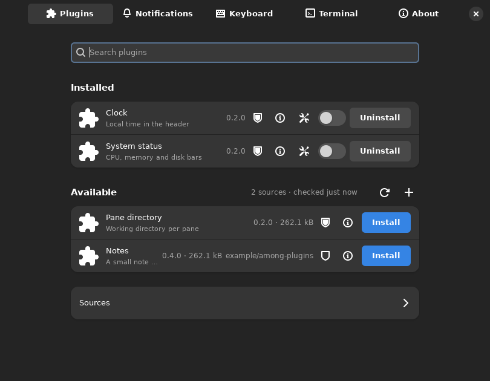
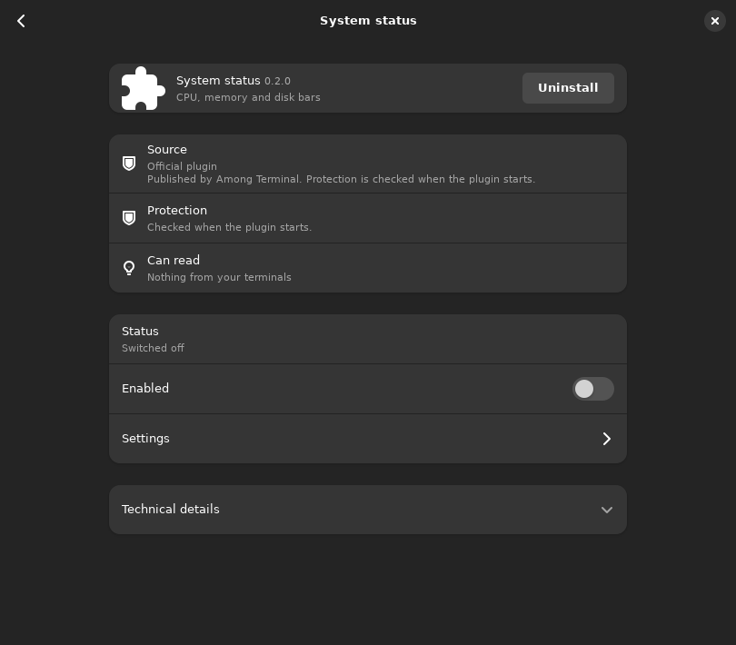
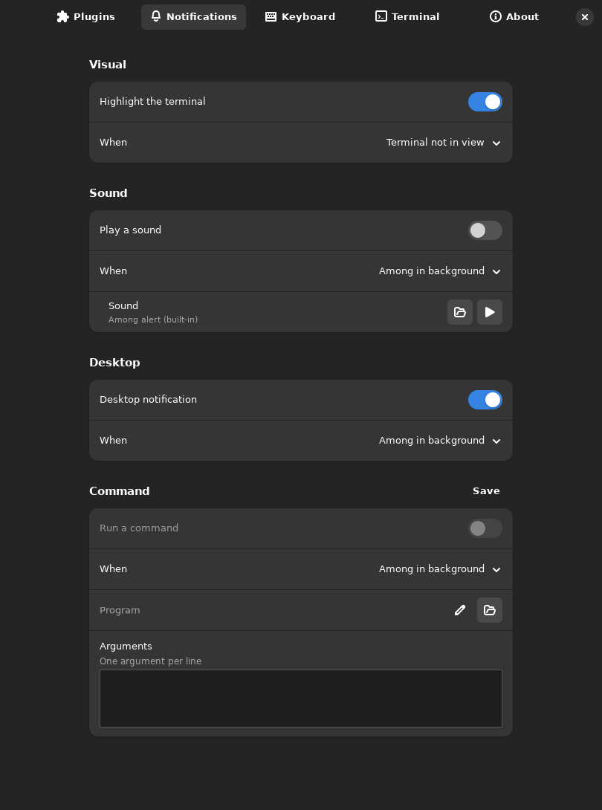
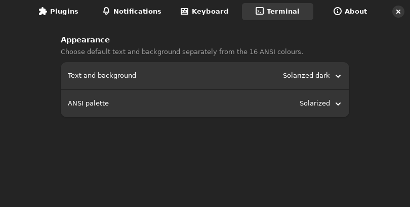
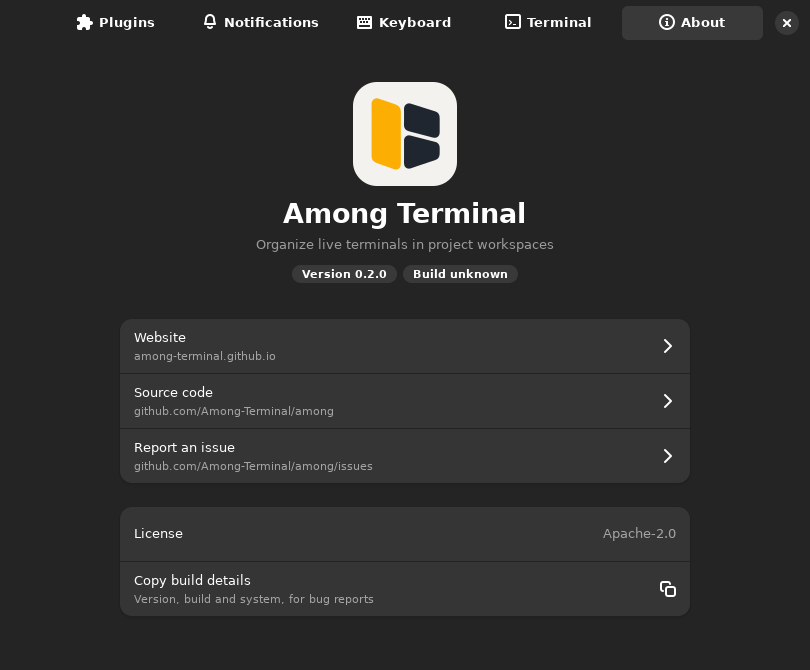

Among Terminal 0.2.0 adds terminal notifications, a plugin system with
sandboxed managed plugins, terminal colour preferences, and several pane and
workspace controls.

- Terminal notifications: a bell in a pane can pulse the unread line at the left
  of the pane until you focus it, raise a desktop notification, play a sound (the
  bundled one or a WAV file you pick), or run a command you configure. Clicking
  a desktop notification focuses the pane that rang. No command is configured or
  enabled by default.
- Plugins are managed. Preferences list installed and available plugins, open a
  page for each plugin with its settings and the access it asks for, and show the
  sources plugins come from. You can add, check and remove sources, and
  install, update or remove plugins there. The official plugins (clock,
  pane-pwd, system-status) live in their own repository,
  [Among-Terminal/among-plugins](https://github.com/Among-Terminal/among-plugins),
  and are released on their own schedule.
- Managed plugins run confined by Landlock and seccomp: a plugin sees only its
  own data directory and the system data it was granted. Kernels older than 6.2
  start a plugin only after you accept reduced protection, which Preferences
  keeps visible. The confinement also denies the system calls that change file
  attributes by path.
- Plugin development mode installs the newest prerelease of a plugin for
  testing, with a visible indicator.
- A Terminal page in Preferences chooses the text and background colours and the
  colour palette from the GNOME Terminal schemes, with no restart.
- Preferences also gain an About page showing the build identity.
- Move a pane to another workspace by dragging it, reorder workspaces with
  native sidebar dragging, and open terminal links with Ctrl+click.
- An expanded pane has a Restore control in its header and keeps focus.
- Plugin list and settings: the first time you open Plugins, the official list
  is fetched once, and a failed fetch shows the reason with a Load button. Each
  row opens its plugin page when clicked, the protection shield is a plain mark
  instead of a button, and the "Review plugin access" dialog is wider. The
  command field of a notification takes one argument per line, with no shell
  involved.
- Fixes: plugin store and settings directories
  that are writable by their own group are accepted, removing a plugin closes
  its details and returns focus to the list, the expanded pane header keeps its
  normal height, and workspace dividers and the sidebar marker stay stable when
  you switch workspaces. Preferences opens tall enough to show the About page
  whole, and GitHub requests for plugin lists and downloads are authenticated
  when the optional AMONG_GITHUB_TOKEN environment variable is set, which
  avoids GitHub's rate limit for anonymous clients.
- Release packages: DEB and RPM for amd64 and arm64, binary archives and
  AppImages; the AppImage tooling is downloaded from a pinned, immutable
  release of our own and every image carries the runtime notice.

See the [plugin guide](https://github.com/Among-Terminal/among/blob/2b2356299e1b0a976eedbc826b7eef22e8fd51db/docs/plugins.md)
for the plugin model and the confinement rules.

### Preferences

