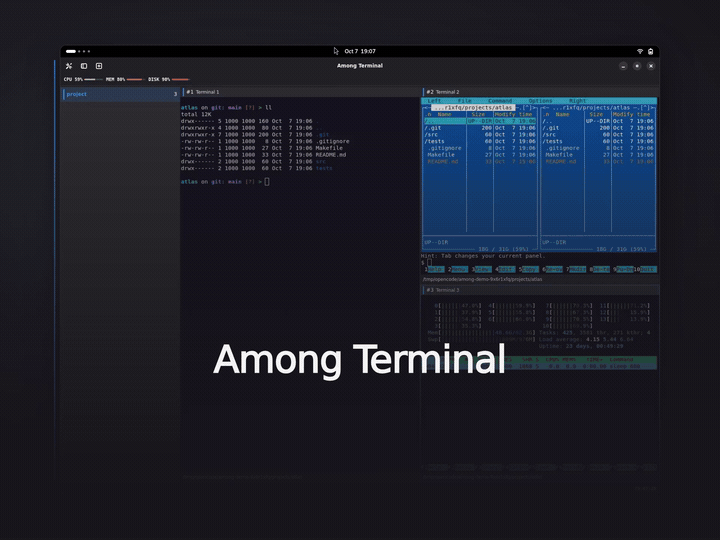

# Among Terminal

A native GNOME terminal multiplexer built with Rust, GTK4, libadwaita and VTE.
Keep shells running in split panes and named workspaces, with keyboard controls
and optional status plugins.

## Installation

See the [installation guide](https://among-terminal.github.io/install/) for
packages, requirements, verification, updates and removal.
Downloads are on the [releases page](https://github.com/Among-Terminal/among/releases).

| x86-64 (`amd64`) | ARM 64-bit (`arm64`) |
|---|---|
|  |  |
|  |  |
|  |  |
|  |  |
|  |  |

AppImages require glibc 2.39 or newer.
Verify downloads with the release's [SHA256SUMS](https://github.com/Among-Terminal/among/releases/latest/download/SHA256SUMS)
as described in the installation guide.

## User guides

- [Overview](https://among-terminal.github.io/overview/) and [features](https://among-terminal.github.io/features/)
- [Panes and workspaces](https://among-terminal.github.io/panes/), [sessions](https://among-terminal.github.io/sessions/) and [shortcuts](https://among-terminal.github.io/shortcuts/)
- [Preferences](https://among-terminal.github.io/preferences/) and [plugins](https://among-terminal.github.io/plugins/)

## Plugin authors

The [plugin template](https://github.com/Among-Terminal/among-plugin-template)
contains the [author guide](https://github.com/Among-Terminal/among-plugin-template/blob/main/docs/guide.md),
[API reference](https://github.com/Among-Terminal/among-plugin-template/blob/main/docs/api.md)
and [release instructions](https://github.com/Among-Terminal/among-plugin-template/blob/main/docs/releasing.md).

## Contributors and packagers

Read [CONTRIBUTING.md](CONTRIBUTING.md) for the development process and documentation
map, and [building from source](docs/build.md) for build requirements.
This repository keeps build, development and packaging documentation.

## License

Original code and examples are [Apache-2.0](LICENSE).
Third-party components retain their own terms: see [NOTICE](NOTICE),
[dependency notices](THIRD_PARTY/inventory.json) and
[licensing](https://among-terminal.github.io/licensing/).
