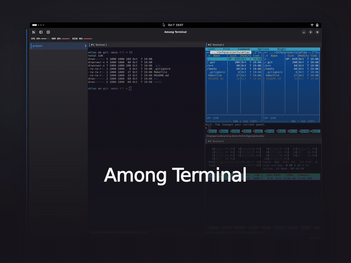

<p></p>

# Among Terminal

A native GNOME terminal multiplexer built with Rust, GTK4, libadwaita and VTE.
Keep shells running in split panes and named workspaces, with keyboard controls
and optional status plugins.

## Installation

Install a ready-made package from [GitHub Releases](https://github.com/Among-Terminal/among/releases).
No Rust toolchain or compilation is needed.

| Format | Installation | Availability |
| --- | --- | --- |
| AppImage | A portable bundle with the main runtime libraries included | In preparation; not downloadable yet |
| DEB | Debian/Ubuntu package; APT installs runtime dependencies | **RC2 preview available**, amd64 and arm64 |
| RPM | Fedora package; DNF installs runtime dependencies | In preparation; not downloadable yet |

### Install the available DEB

Download a ready-made **0.1.0 RC2 preview** package for
[Ubuntu 24.04 or Debian 13](https://among-terminal.github.io/install/),
on amd64 or arm64. For Ubuntu 24.04 on amd64, run in the download folder:

```sh
sudo apt install ./among-terminal_0.1.0.rc.2-1.ubuntu24.04_amd64.deb
```

Launch **Among Terminal** from the applications menu. No Git, Rust or build
scripts are required; `apt` installs the required runtime libraries automatically.
This is a prerelease, not a stable release.
[Release downloads](https://github.com/Among-Terminal/among/releases/tag/v0.1.0-rc.2) ·
[Updates and removal](https://among-terminal.github.io/install/).

For the optional `cargo install --git` source-build route, see
[building from source](docs/build.md#cargo-install-from-git).

[](https://among-terminal.github.io/#demo)

[Watch the demo](https://among-terminal.github.io/#demo) ·
[Feature guide](https://among-terminal.github.io/features/) ·
[Plugin development](https://among-terminal.github.io/plugin-development/)

## Features

- Split, resize and rearrange panes without restarting their shells.
- Switch between named, colour-coded workspaces with a collapsible sidebar.
- Navigate by keyboard, zoom a pane and customize shortcuts.
- Restore workspace layouts and directories into fresh shells.
- Add clocks, resource meters and per-pane status through separate-process plugins.
  Plugins are optional and disabled by default.

## Contributing

For source builds and contributions, see [building](docs/build.md) and
[CONTRIBUTING.md](CONTRIBUTING.md).

## License

Original code and examples are [Apache-2.0](LICENSE).
Third-party components retain their own terms: see [NOTICE](NOTICE),
[dependency notices](THIRD_PARTY/inventory.json) and [licensing](docs/licensing.md).
