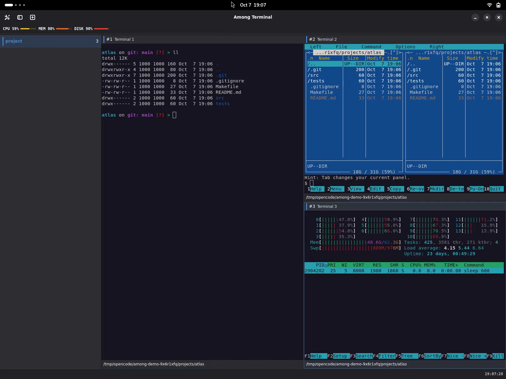
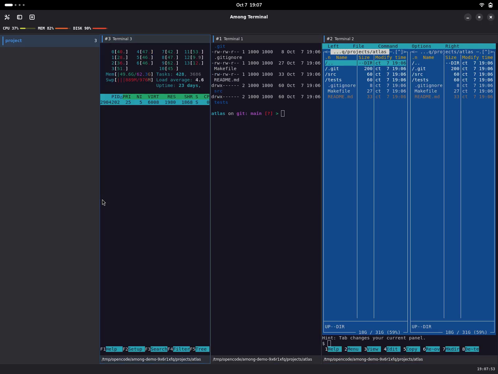
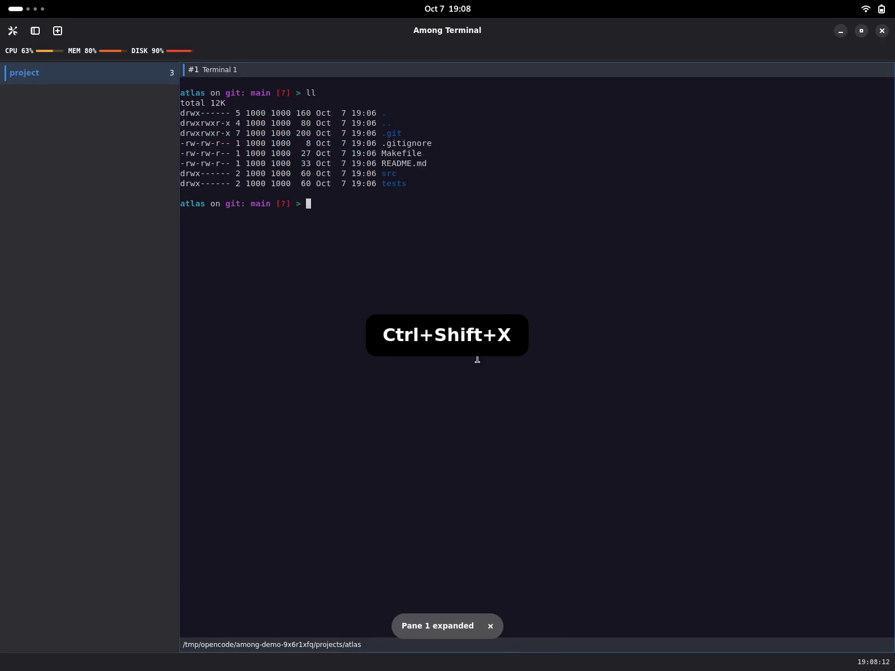
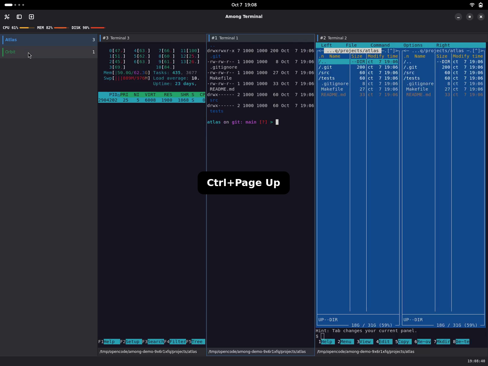
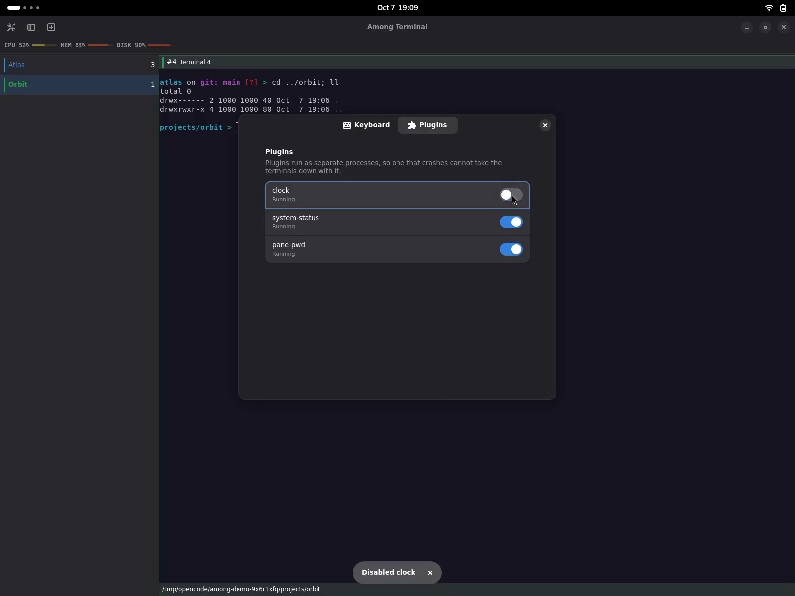
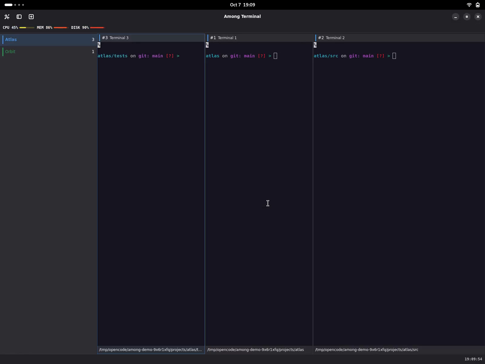
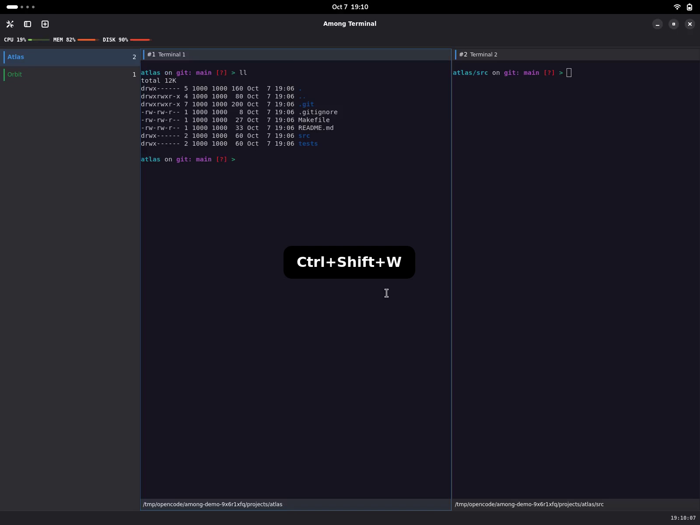
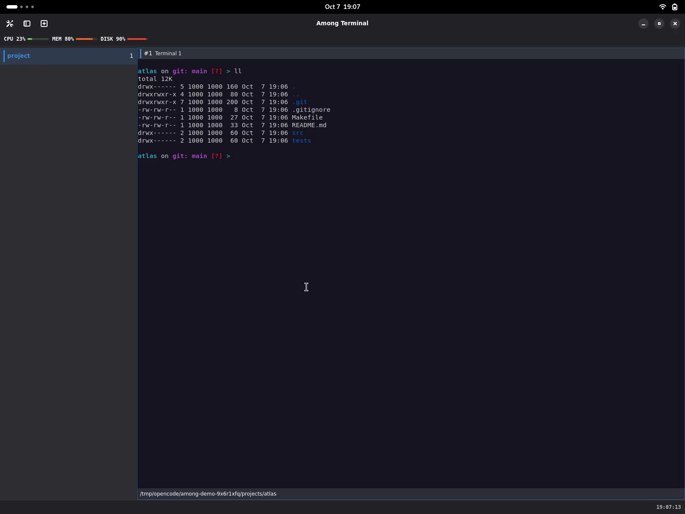

# Features in practice

Among Terminal keeps native VTE terminals in a single GNOME window. This guide
connects each everyday control to a real demonstration and its detailed reference.
The recordings use synthetic projects; zsh, Starship, `ll`, `mc` and `htop` are
demo tools, not software installed or configured by Among Terminal.

[Full-length overview videos](overview.md) ·
[Default shortcuts](shortcuts.md)

## Split and resize terminals

Press **Ctrl+Shift+N** to split the focused pane. A wide pane splits side by side;
a tall pane splits top to bottom. Repeat to build a nested layout with separate
shells, for example a project listing, file manager and process monitor. The new
terminal starts in the directory of the pane it was split from, so both halves
open where the work already is. See [panes](panes.md#splitting-a-pane).

Drag a divider to allocate more space, or press **Ctrl+Shift** with an arrow to
move the divider next to the focused pane in that direction: Left/Right move a
side-by-side divider, Up/Down a stacked one. Resizing keeps the terminals
running rather than starting replacement shells.

**Demonstrations:** [split panes](media/features/02-split-resize.mp4) ·
[keyboard resize](media/features/02b-keyboard-resize.mp4) ·
[mouse resize](media/features/02c-mouse-resize.mp4).

## Rearrange panes without restarting tools

Drag a **pane header**, not terminal text, onto another pane's edge. Left/right
edges place panes side by side; top/bottom edges stack them. The drop indicator
previews the destination. The moved terminal retains its process and focus;
dragging inside terminal text still selects text.

[Pane movement and drop rules](panes.md#dragging-a-pane-to-a-new-position).

## Focus, zoom and fullscreen

- Click a terminal or its header to focus it; **Alt+Arrow** moves between panes.
- **Ctrl+Shift+X** expands the focused pane to fill its workspace. Press again to
  recover the same nested layout; hidden panes keep running.
- **F11** enters or leaves fullscreen. Normal startup is maximized, not fullscreen.

**Demonstrations:** [focus](media/features/04-focus.mp4) ·
[zoom and restore](media/features/04b-zoom.mp4) ·
[fullscreen](media/features/04c-fullscreen.mp4).

## Organize projects into workspaces

Use the header's **New workspace** button or **Ctrl+Shift+T**. A single click on a
sidebar entry switches to that workspace; a double-click turns its name into a field
to type in. **Enter** applies the name, **Escape** keeps the one the workspace
already has, and clicking elsewhere applies what was typed. A name that is empty or
only spaces is refused, and the row shows the name the workspace still holds. Only
one name is edited at a time: starting a rename on another workspace ends the first
one. Each workspace has a colour marker and a live terminal count.

Renaming changes nothing else: the workspace's terminals keep running, their
directories and layout stay as they were, and the keyboard goes back to the terminal.

Click a sidebar entry, use **Alt+1…9**, or cycle with **Ctrl+PageUp/PageDown**.
Inactive workspaces keep their terminals and processes running. The sidebar
collapse button reduces the list to a strip: colours and counts remain visible,
and every workspace remains reachable.

Drag the expanded sidebar's right edge to change its width. The chosen width
returns after expanding the strip and after restarting the application. Resizing
the sidebar leaves the workspace's panes and running processes intact.

Actions and plugin notifications do not show bottom pop-up messages. Diagnostics
remain in stderr, with storage warnings also available in Settings; explicit
plugin header, footer and sidebar content remains visible as before.

**Demonstrations:** [create, rename and switch](media/features/05-workspaces.mp4) ·
[collapse and expand the sidebar](media/features/05b-sidebar.mp4).

## Scroll with a wheel or a touchpad

A mouse wheel click moves the terminal's scrollback the way the terminal library
moves it: about a tenth of the pane's rows per click, more in a tall pane. That is
left alone deliberately.

A touchpad is calibrated differently, and this is the difference you feel. A
gesture covers a distance on the surface, and that distance becomes the distance
the history moves, converted to text rows — the same calibration the rest of the
desktop uses. Without it the terminal library multiplied the gesture's distance by
a tenth of the pane's rows, so the same finger movement travelled several times
further here than in any other application, and further still the taller the pane.

Scrolling stays with the terminal program when the program owns the screen. A
full-screen editor, pager or system monitor receives the gesture as its own keys,
and the scrollback does not move underneath it. Each pane has its own position,
so scrolling one does not move another.

## Clipboard, links and pane actions

Right-click a terminal, or press **Shift+F10** in the focused terminal, to open
its native menu. In mouse-reporting programs, use **Shift+right-click**; an
ordinary right-click still goes to the program. Menu actions belong to the pane
that requested them, including when another pane was previously focused.

**Copy** copies that pane's selected text; without selection it is disabled.
**Paste** uses VTE's normal text-paste handling, including bracketed paste when
requested by the terminal program; without a clipboard text format it is disabled.
**Select All** selects available terminal text and scrollback, not other panes.
Copy/Paste availability follows selection and clipboard changes even while the
menu is open. Pasting sends text to the program: it is not session command replay,
but a shell can interpret pasted newlines, so only paste text you trust.

Pointer-opened menus can offer **Copy Link** and **Open Link** for explicit
hyperlinks and plain absolute **http**, **https** and **mailto** URLs. An explicit
hyperlink takes precedence over its displayed text. Other valid explicit schemes
are copy-only; malformed, control-containing or oversized targets are not offered.
Keyboard-opened menus omit link entries rather than reuse an old pointer target.
Open Link requests the desktop handler asynchronously, never a shell command;
handler failure shows an error while the terminal remains usable.

**Ctrl+left-click** follows a link without opening the menu: an explicit hyperlink
opens its target rather than its displayed text, and a plain absolute **http**,
**https** or **mailto** URL opens as written, without trailing sentence
punctuation. Only those three schemes launch; another explicit scheme opens
nothing and keeps the click, and a target that cannot be parsed is refused the
same way. Plain clicks, other modifiers and drags still select, scroll and reach
the program as before, and opening a link leaves the selection and scrollback
unchanged. A program that enabled mouse reporting receives every click except a
Ctrl+click on an openable link. A refused launch is reported on stderr and the
terminal stays usable.

**Split Pane**, **Expand/Restore Pane** and **Close Terminal** reuse the existing
pane controls. Their shortcut hints follow Settings, and removing a shortcut does
not disable its menu action. Arrow keys navigate, Enter activates, and Escape
returns to terminal input. No context-menu recording is included in the videos.

[Detailed menu and pane rules](panes.md#terminal-context-menu).

## Optional live status plugins

After [installing the examples](plugins.md#installing), open **Settings** with
**Ctrl+,** and select **Plugins**. All three examples are disabled by default;
enable only the ones you want. Switches apply immediately and persist on restart.

| Plugin | Where it appears | What it reports |
| --- | --- | --- |
| `clock` | Right application footer | Local time, including seconds |
| `system-status` | Application header | CPU, memory and root-filesystem usage, with percentages and meters |
| `pane-pwd` | Each pane footer | That pane's known directory; the tooltip contains the full path |

Directory changes need your shell to publish **OSC 7**; installing Starship alone
does not supply it. Unknown directories are not replaced with another pane's
path. Resource readings describe the plugin's process/mount namespace, which may
differ from the whole host in a sandbox. Plugins run as separate processes, but
that is fault isolation, not a security sandbox: install only trusted code.

[Live status and directory integration](plugins.md#live-status-examples) ·
[Third-party plugin protocol](plugins.md#protocol).

## Restore a layout, not yesterday's commands

On a new launch with a saved session, choose **Restore** or **Start new**.
Restoration recovers workspace names, colours, nested splits, focus and known
directories, including inactive workspaces. Every terminal starts a **fresh
shell**: commands, running tools and scrollback are not replayed.

The demonstration restores four shells in different project directories, then
manually runs `ll`. Changed directories require shell OSC 7 reporting even if
the directory plugin is disabled. Missing directories fall back to an accessible
home/startup directory and are reported in Settings. Storage failures are visible
and retryable; recent changes can be lost after a crash.

[Session consent, storage and recovery limits](sessions.md).

## Close a pane and keep working

**Ctrl+Shift+W** closes the focused pane and its process. The sibling that fills
the space receives focus, so the next keystrokes reach a surviving terminal.
Closing a workspace's last pane closes that workspace; the final workspace asks
for confirmation before the application exits. Closing a pane can end a running
job: this is not a detach operation.

[Closing, process exit and focus rules](panes.md#closing-and-exiting).

## Appearance and preferences

The native interface supports light and dark styling. Shell prompts and terminal
colours are configured separately; Among Terminal does not import GNOME Terminal
profiles.

In **Settings → Keyboard**, select an action and press a new shortcut, or use
**Escape** to remove its binding. Changes take effect without restarting and are
saved together with explicit unbinding. Save failures leave the current edit
active for this session and show a warning; a later edit retries saving.

Shortcut editing and storage recovery are documented but are not demonstrated
in these clips. See [shortcut controls](shortcuts.md) and
[preference persistence](preferences.md).

The written instructions explain each action without requiring video playback.
Demonstrations show native X11 behaviour; they do not establish support for
untested platforms or assistive technologies.
