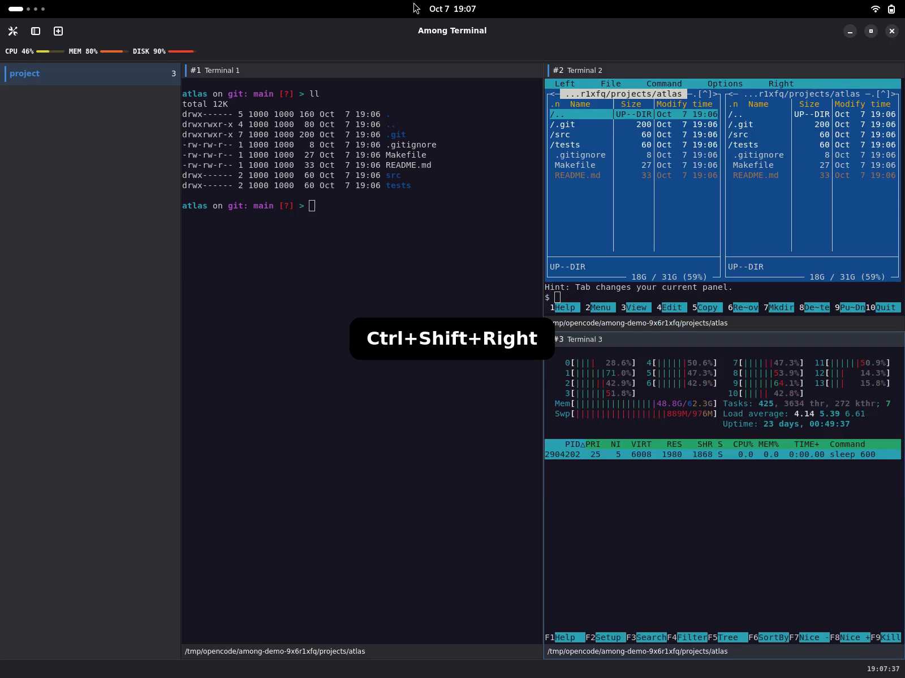
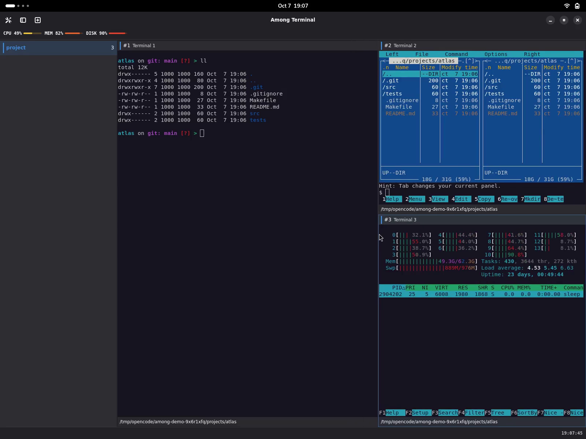
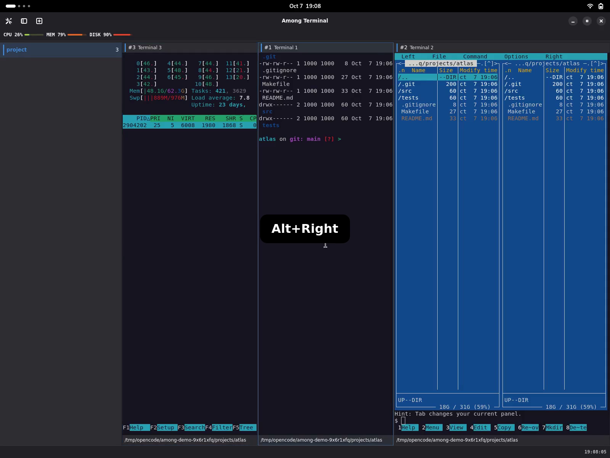
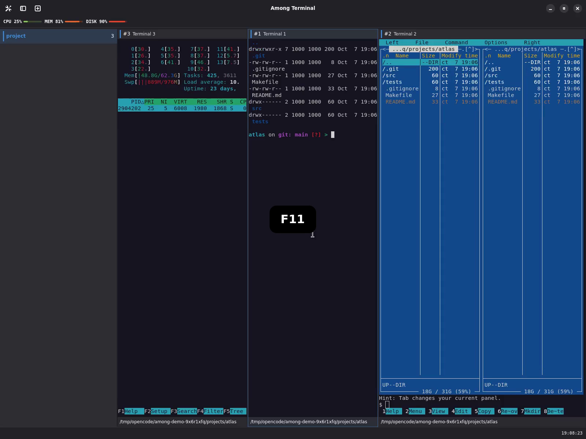
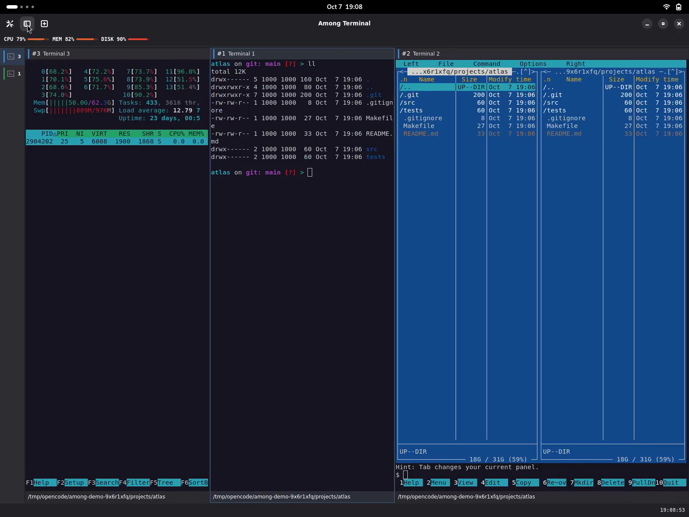

# Feature videos

[Full-length overview videos](../../overview.md) ·
[Feature guide and controls](../../features.md)

These silent real recordings use synthetic projects, isolated zsh/Starship and
GNOME Terminal colours and an ASCII prompt. Only actual shortcut presses are
highlighted in bold on centred rounded black badges; there are
no scene subtitles. Click a preview to open/download its MP4. Only the first
video shows light appearance; all remaining videos are dark.

## Light and dark appearance — 14 seconds

The same native interface and coloured shell listing in light and dark styling.

## Splits — 9 seconds

Two real splits create separate panes for a colourful `ll`, Midnight Commander
and htop. htop shows an owned test process, not personal command lines.

## Keyboard resize — 4 seconds

`Ctrl+Shift+Right` changes the focused pane's divider without leaving the terminal.

## Mouse resize — 5 seconds

The visible cursor drags a live divider; terminal programs reflow with their panes.

## Pane drag-and-drop — 6 seconds

Dragging a pane header to a different edge rearranges the live pane tree.

## Focus — 5 seconds

`Alt+Right` changes pane focus, then a pointer click focuses a terminal directly.

## Zoom — 8 seconds

`Ctrl+Shift+X` expands a pane, then restores the original layout.

## Fullscreen — 6 seconds

`F11` enters fullscreen and returns to the windowed layout.

## Workspaces — 11 seconds

Rename Atlas inline, create and name Orbit, then return to the still-running
Atlas terminals with `Ctrl+Page Up`.

## Sidebar — 7 seconds

Use the header button to hide the sidebar to a strip and show it again.

## Plugins — 18 seconds

Open Settings with `Ctrl+,`. Disable and re-enable clock, system-status and
pane-pwd through their real switches: clock, resource meters and directory
content withdraw and return.

## Session restoration — 17 seconds

Exit and restart, choose Restore, and reopen the named layout with four fresh
shells in Atlas, Atlas/src, Atlas/tests and Orbit. No commands or tools replay.
Run `ll` and switch workspaces to inspect the restored project directories.

## Close a pane — 5 seconds

`Ctrl+Shift+W` closes one pane. Its surviving sibling immediately accepts `ll`.

[Capture instructions](../../demo.md) · [Exact media hashes and review scope](manifest.json)
