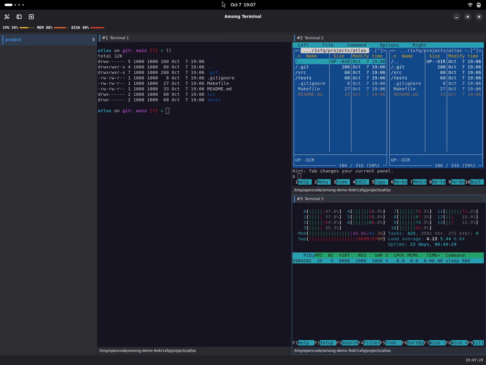
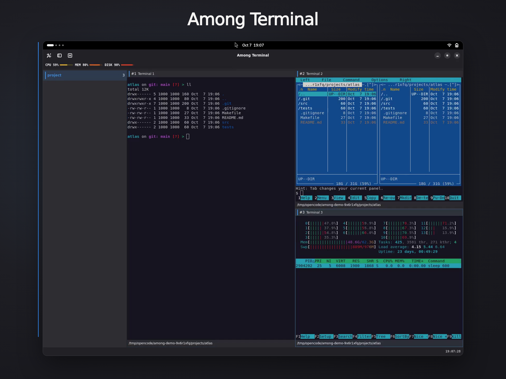

# Among Terminal overview

Among Terminal combines native VTE terminals, nested panes and live workspaces
in a GNOME window. The short [README film](../README.md) introduces the interface;
the full-length recordings here cover more workflows and controls.

## Complete workflow tour

**[Watch the overview · 1 min 53 s](media/among-terminal-overview.mp4)**

The original silent tour joins the reviewed feature recordings with direct cuts:
themes, splitting and resizing, pane movement, focus, zoom, fullscreen,
workspace naming and switching, sidebar controls, plugins, consented session
restoration and pane closing. Recorded shortcuts remain visible; no soundtrack
or explanatory subtitles are added.

## Extended presentation

**[Watch the extended presentation · 2 min 1 s](media/among-terminal-promo.mp4)**

The earlier long-form film presents the recorded workflows on a charcoal stage.
It is retained here separately from the approved 23-second README film.

## Explore individual features

- [Feature guide](features.md): demonstrations alongside controls and caveats.
- [Panes](panes.md), [sessions](sessions.md), [preferences](preferences.md)
  and [plugins](plugins.md): detailed references.

Use fullscreen to inspect terminal text. Previews link to MP4 files; GitHub
inline playback is not assumed. The recordings use isolated synthetic projects,
not personal shell startup files.
