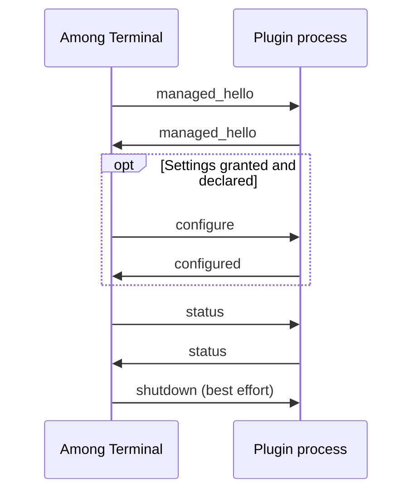

# Plugin API reference

Among Terminal 0.2.0 speaks managed plugin API **1.2**. This reference covers
the JSON exchanged with a running plugin and its `among-plugin.json` manifest.
For installation, access review, sandboxing and a first plugin, see the
[plugin guide](plugins.md).

## Contents

- [Transport and lifecycle](#transport-and-lifecycle)
- [Version negotiation](#version-negotiation)
- [Feature grants](#feature-grants)
- [Targets and scopes](#targets-and-scopes)
- [Message catalogue](#message-catalogue)
- [Status and fragments](#status-and-fragments)
- [Terminal context and enumeration](#terminal-context-and-enumeration)
- [Terminal events](#terminal-events)
- [Configuration](#configuration)
- [Notifications](#notifications)
- [Errors and failure handling](#errors-and-failure-handling)
- [Manifest](#manifest)
- [Settings schema](#settings-schema)
- [Implementation sources](#implementation-sources)

## Transport and lifecycle

The host writes UTF-8 JSON to the plugin's stdin. The plugin writes one JSON
object per line to stdout, ending each line with `\n` and flushing it. Do not
write logs to stdout. The host discards the child's stderr.

A frame, including its newline, may occupy at most 65,536 bytes. JSON nesting is
limited to 32 levels; duplicate object keys are rejected. The stdout queue holds
16 frames. Oversized frames, invalid UTF-8 and queue overflow stop the process.
Malformed JSON is rejected without a wire response. Top-level messages and
status fragments currently ignore unknown fields; targets, scopes, notification
payloads, manifests and settings schema objects reject them. Unknown message
types are rejected.

The host starts an enabled, reviewed plugin in its package directory and sends
`managed_hello`. The plugin must answer within five seconds. Only after that
exchange may it answer status requests or use granted features. If settings are
available and granted, the host sends `configure` after the handshake.



All managed messages carry `session` and `generation` strings, except
`shutdown`. Copy these opaque strings from the handshake. A session identifies
the host context; a generation identifies this execution of the plugin. Replies
from an older generation cannot update the current one.

On stopping, the host attempts to send `{"type":"shutdown"}`. There is no
acknowledgement. It then terminates the supervised process group, with a
500 ms interval between SIGTERM and SIGKILL. Treat EOF as shutdown too; receipt
of the shutdown frame is not guaranteed.

## Version negotiation

The manifest and protocol use these versions:

| Version | Meaning |
| --- | --- |
| Manifest `schema_version` | Manifest format; currently exactly `1`. |
| Manifest `version` | Plugin release label, checked against its installation metadata. |
| Manifest `api.major` / `api.minor` | Required host API major and minimum minor. The current host accepts major `1` and a minimum minor no greater than `2`. |
| Settings `version` | Positive schema version for saved values; it must match saved settings exactly. |

The host advertises `major: 1`, `minor: 2`. The reply must echo **both values
exactly**, even if the manifest declares a lower minimum minor. It must also echo
`identity`, `session` and `generation`. `identity` comes from the installation
record, for example `github:12345/clock` or `development/clock`; it is not the
manifest's display name.

The host sends the reviewed feature set. The reply may select a subset, provided
it includes every required feature and satisfies the dependencies below. An
unsupported required feature prevents startup. An unsupported optional feature
is not granted. Legacy `hello` handshakes are not supported.

Host to plugin:

```json
{"type":"managed_hello","major":1,"minor":2,"identity":"development/hello","session":"session-example","generation":"generation-example","features":["status"]}
```

Plugin to host:

```json
{"type":"managed_hello","major":1,"minor":2,"identity":"development/hello","session":"session-example","generation":"generation-example","features":["status"]}
```

The example tokens are illustrative. A running plugin must echo the tokens it
actually receives.

## Feature grants

Features are declared in the manifest, approved in access review, then selected
in the handshake. A declaration alone grants no access.

| Feature | Permission |
| --- | --- |
| `status` | Receive status requests and return fragments. |
| `settings` | Receive validated configuration values. |
| `context.terminals` | Receive terminal and workspace references; enumerate context; use workspace and pane targets. |
| `context.cwd` | Receive the terminal-reported working directory. Requires `context.terminals`. |
| `context.title` | Receive terminal titles. Requires `context.terminals`. |
| `context.process` | Receive `running` and process-exit events. Requires `context.terminals`. |
| `events.terminal` | Receive terminal events. Requires `context.terminals`. |
| `system.metrics` | Read `/proc/stat`, `/proc/meminfo` and `/proc/loadavg` through the sandbox. |
| `notifications.produce` | Submit notification events. |
| `notifications.ui` | Submit notification content and actions for host-rendered slots. |
| `notifications.deliver` | Receive delivery jobs for declared notification channels. |

Notification features are offered only when the host notification backend is
available. `notifications.produce` and `notifications.deliver` cannot be granted
to the same process. Either role may also use `notifications.ui`. Notification
grants do not grant network or arbitrary filesystem access.

## Targets and scopes

A target is one of these objects. `reference` is a canonical unsigned 64-bit
decimal **string**, never a JSON number: `"12"` is valid; `12`, `"012"`, `"+12"`
and `"-1"` are invalid. References identify live objects; workspace references
are not sidebar positions.

```json
{"kind":"application"}
```

```json
{"kind":"workspace","reference":"12"}
```

```json
{"kind":"pane","reference":"7"}
```

A scope has exactly two required fields: `slot` (string) and `target` (object).

| `slot` | Target kind | Host location |
| --- | --- | --- |
| `app_header` | `application` | Shared application header. |
| `app_footer` | `application` | Shared application footer. |
| `workspace_header` | `workspace` | Active workspace's header; an inactive target does not resolve. |
| `workspace_summary` | `workspace` | Summary beside a workspace in the sidebar. |
| `pane_header` | `pane` | Header of that pane. |
| `pane_footer` | `pane` | Footer of that pane. |

```json
{"slot":"pane_footer","target":{"kind":"pane","reference":"7"}}
```

The host chooses a status request's scope. Its reply carries only `request_id`,
so the plugin cannot redirect it to another slot. Closed targets and stale
workspace-header targets cannot receive the reply.

## Message catalogue

Every row below includes a required string `type`. Unless stated otherwise, it
also includes required string `session` and `generation` fields. Fields listed
without “optional” are required. `u64`, `u32` and `i32` mean JSON integers in the
corresponding Rust type's range. Arrays and objects are JSON values, not encoded
JSON strings. The exchanges below are independent examples. Each requires its
stated grants; the initial status-only handshake does not authorize configuration
or notifications.

| Direction | `type` | Additional fields |
| --- | --- | --- |
| Both | `managed_hello` | `major`: u32; `minor`: u32; `identity`: string; `features`: array of feature strings. |
| Host → plugin | `status` | `request_id`: u64; `scope`: scope object; `context`: context object. |
| Plugin → host | `status` | `request_id`: u64; `fragments`: array; optional `refresh_ms`: u64 or null. |
| Host → plugin | `configure` | `revision`: u64; `version`: u32; `values`: settings object. |
| Plugin → host | `configured` | `revision`: u64; `outcome`: configuration outcome; optional `reason`: configuration reason or null. |
| Plugin → host | `enumerate` | `request_id`: u64; `scope`: scope object; optional `cursor`: reference string or null. |
| Host → plugin | `context_page` | `request_id`: u64; `scope`: scope object; `context`: context object. |
| Host → plugin | `event` | `event`: terminal event object. |
| Plugin → host | `notification_event` | `event`: notification event object. |
| Plugin → host | `notification_contribution` | `contribution`: notification content object. |
| Plugin → host | `withdraw_notification` | `id`: contribution ID string. |
| Host → plugin | `notification_action` | `contribution`: ID string; `revision`: u64; `action`: action ID string. |
| Host → plugin | `deliver` | `delivery`: delivery object. |
| Plugin → host | `delivery_result` | `job_id`: u64; `outcome`: delivery outcome. |
| Host → plugin | `cancel_delivery` | `job_id`: u64. |
| Host → plugin | `shutdown` | No other fields, including no session or generation. |

## Status and fragments

The plugin must reply to each `status` request within five seconds, echoing its
`request_id`. An empty `fragments` array is valid. Ordinary slots replace that
plugin's previous content with the reply's fragments. Unrequested or duplicate
reply IDs are ignored.

Host to plugin, with only `status` granted:

```json
{"type":"status","session":"session-example","generation":"generation-example","request_id":1,"scope":{"slot":"app_footer","target":{"kind":"application"}},"context":{"session":"session-example"}}
```

Plugin to host:

```json
{"type":"status","session":"session-example","generation":"generation-example","request_id":1,"refresh_ms":1000,"fragments":[{"text":"Ready","style":"success","priority":10}]}
```

Each fragment has these optional fields:

| Field | Type and default | Rules |
| --- | --- | --- |
| `text` | String or null; null | At most 512 Unicode characters. |
| `icon` | String or null; null | GTK theme icon name, such as `folder-symbolic`. Missing theme icons are dropped. This is not a filesystem path. |
| `style` | String or null; null | `default`, `success`, `warning`, `error`, `accent`, `dim`. Unknown values use `default`. |
| `tooltip` | String or null; null | Tooltip text; subject to the frame byte limit. |
| `priority` | i32; `0` | Between `-1000` and `1000`, inclusive. |
| `meter` | Number or null; null | Finite fraction from `0` to `1`, inclusive. Supply readable text too. A meter alone is not accepted content. |

A fragment needs nonempty text or a nonempty icon name. A reply may contain at
most 64 fragments. The host controls fonts, placement and rendering; the API
does not accept GTK widgets, CSS or terminal input.

`refresh_ms` may be omitted or null for event-driven collection. An integer
requests timed collection, up to `3600000` ms. The validator accepts `0`; use a
positive interval to avoid requesting collection on every host polling cycle.
This is a scheduling request, not an exact timer.

For `workspace_summary`, the host uses only the first fragment's text, icon,
tooltip and style. It does not render that fragment's meter or priority, and
collects summaries on its own interval instead of using `refresh_ms`. In the
current implementation, an empty summary reply leaves an existing summary in
place; do not rely on it to clear the sidebar entry.

## Terminal context and enumeration

Every context contains `session`. Without `context.terminals`, application
context contains only that field, and pane/workspace status requests are not
issued to that plugin.

With `context.terminals`, context contains:

| Field | Type | Presence |
| --- | --- | --- |
| `session` | String | Always. |
| `terminals` | Array of terminal objects | Always with the grant; limited to the requested target. |
| `next_cursor` | Reference string or null | Always with the grant; null means no next page. |
| `active_workspace` | Reference string or null | Application scopes only. |
| `focused_pane` | Reference string or null | Application scopes only. |

Terminal objects contain `pane` and, when the workspace resolves, `workspace`
reference strings. Additional fields depend on grants:

| Field | Grant | Value |
| --- | --- | --- |
| `cwd` | `context.cwd` | String or null when unknown/unavailable. |
| `title` | `context.title` | String or null when unknown/unavailable. |
| `running` | `context.process` | Boolean. |
| `notification_generation` | `notifications.produce` or `notifications.ui` | String when a live notification source exists for the pane. |
| `unavailable` | Relevant text grant | Array containing `cwd` and/or `title` when supplied text exceeds its bounds. Omitted otherwise. |

Ungranted fields are omitted. Granted but unknown `cwd` and `title` are null.
Text beyond 4096 UTF-8 bytes or 8192 bytes after JSON encoding is replaced with
null and named in `unavailable`.

Pages contain at most 32 terminals, with the terminal array bounded to 28 KiB.
Use `next_cursor` in an `enumerate` request for the same scope. Omit `cursor` or
use null for the first page. Choose a request ID and wait for `context_page`
before requesting another page; only one pending enumeration is allowed.
Enumeration requires `context.terminals`, but does not require `status`.

Plugin to host, assuming the pane is live and terminal context is granted:

```json
{"type":"enumerate","session":"session-example","generation":"generation-example","request_id":20,"scope":{"slot":"pane_footer","target":{"kind":"pane","reference":"7"}},"cursor":null}
```

Host to plugin, with `context.cwd` also granted:

```json
{"type":"context_page","session":"session-example","generation":"generation-example","request_id":20,"scope":{"slot":"pane_footer","target":{"kind":"pane","reference":"7"}},"context":{"session":"session-example","terminals":[{"pane":"7","workspace":"12","cwd":"/home/user/project"}],"next_cursor":null}}
```

## Terminal events

Events require both `events.terminal` and `context.terminals`. The nested `event`
object contains `kind`, `pane` and `workspace`; the latter two are reference
strings. There is no event acknowledgement.

| `kind` | Additional fields |
| --- | --- |
| `pane_opened` | None. |
| `pane_closed` | None. |
| `process_exited` | Required `status`: i32. Delivered only with `context.process`. |
| `working_directory_changed` | `cwd`: string or null, only with `context.cwd`; optional `unavailable` array with the same text-bound rules as context. |
| `workspace_activated` | None; references the focused pane in the newly active workspace. |

```json
{"type":"event","session":"session-example","generation":"generation-example","event":{"kind":"process_exited","status":0,"pane":"7","workspace":"12"}}
```

## Configuration

Configuration requires a declared settings schema and a negotiated `settings`
grant. The host validates stored values against that schema before delivery.
`configure.version` is that schema's version, and `values` contains
only declared, supported fields with accepted values or defaults. It does not
contain unrecognized stored keys or unavailable secret values.

Host to plugin:

```json
{"type":"configure","session":"session-example","generation":"generation-example","revision":1,"version":1,"values":{"label":"Ready"}}
```

Plugin to host, after applying the values:

```json
{"type":"configured","session":"session-example","generation":"generation-example","revision":1,"outcome":"applied"}
```

| `outcome` | Meaning |
| --- | --- |
| `applied` | The current process applied this revision. The host invalidates its previous content. |
| `rejected` | The process did not apply it. Optional `reason` defaults to `invalid_configuration`. |
| `restart_required` | Applying it requires a new process. |

`reason` accepts `invalid_configuration`, `unsupported_version`, `unavailable`
or `internal_error`. It is meaningful for `rejected`; there is no free-text
reason field. A complete rejection is:

```json
{"type":"configured","session":"session-example","generation":"generation-example","revision":1,"outcome":"rejected","reason":"unsupported_version"}
```

Reply within five seconds. Only the latest pending revision can change the
displayed configuration state. A timeout marks configuration unavailable; an old
or late acknowledgement cannot mark it applied. With `apply: "restart"`, edits
to a running plugin mark it as requiring restart instead of sending a live edit.

## Notifications

Notification events, visible notification content and delivery jobs are separate
messages. Producing an event does not itself create a custom widget or select a
delivery channel. The host applies the user's notification policies.

### Producing an event

`notification_event` requires `notifications.produce`. Its `event` object has:

| Field | Required | Type and rules |
| --- | --- | --- |
| `sequence` | Yes | Positive u64, strictly increasing within the plugin generation. |
| `target` | Yes | Application or pane target. Workspace targets are refused. |
| `message` | Yes | Nonblank string, at most 240 Unicode characters and 1024 UTF-8 bytes. |
| `source_generation` | For pane targets | String copied from that terminal's `notification_generation`; otherwise optional/null. |
| `causal_job` | No | u64 or null. Any non-null value is rejected to prevent delivery feedback. |

Pane targets also require `context.terminals`. The source must still be live.
Events have a two-second per-producer cooldown. A rejected rate-limited sequence
is still consumed; use a larger sequence for the next attempt. Notification text
must not contain control characters or bidi override/isolate characters.

```json
{"type":"notification_event","session":"session-example","generation":"generation-example","event":{"sequence":1,"target":{"kind":"application"},"message":"Build complete"}}
```

There is no success acknowledgement or rejection frame for this message.

### Visible content and actions

`notification_contribution` requires `notifications.ui`. Its `contribution`
object has:

| Field | Required | Type and rules |
| --- | --- | --- |
| `id` | Yes | Local ID: 1 to 64 lowercase ASCII letters, digits or hyphens. |
| `revision` | Yes | Positive u64, increasing for this ID within the generation. |
| `scope` | Yes | A live scope from the scope table. |
| `text` | Yes | Nonblank string; at most 512 characters and 2048 UTF-8 bytes. |
| `source_generation` | For pane targets | Current `notification_generation`; otherwise optional/null. |
| `tooltip` | No | String or null; if provided, nonblank, at most 512 characters and 2048 bytes. Newlines and tabs are allowed. |
| `icon` | No | Null, `package`, or `theme:` followed by 1 to 128 ASCII letters, digits or hyphens. `package` selects the statically inspected manifest icon. |
| `style` | No | `default` (default), `success`, `warning`, `error`, `accent`, `dim`. Unknown values are rejected. |
| `actions` | No | Array, empty by default; at most four objects with required `id` and `label`. IDs follow the local ID rules and must be distinct; labels are nonblank strings of at most 64 characters. |

Text fields reject control and bidi override/isolate characters, except the
tooltip's permitted newlines and tabs. Workspace and pane scopes require
`context.terminals`.

```json
{"type":"notification_contribution","session":"session-example","generation":"generation-example","contribution":{"id":"build","revision":1,"scope":{"slot":"app_footer","target":{"kind":"application"}},"text":"Build complete","style":"success","actions":[{"id":"dismiss","label":"Dismiss"}]}}
```

When the user activates its action, the host sends:

```json
{"type":"notification_action","session":"session-example","generation":"generation-example","contribution":"build","revision":1,"action":"dismiss"}
```

The plugin can remove its content with:

```json
{"type":"withdraw_notification","session":"session-example","generation":"generation-example","id":"build"}
```

Content expires after ten seconds. A higher revision replaces the same ID and
renews its lifetime. Each plugin generation may use at most eight contribution
IDs, including withdrawn IDs; the host holds at most 128 contributions in total.
Withdrawal does not reset an ID's revision history. Old callbacks cannot operate
on a newer revision or a replacement process. Action activation is limited to
once per 250 ms for a contribution, with at most 16 queued actions globally.

### Delivery providers

`notifications.deliver` permits delivery through channels declared in the
manifest and enabled by the user. It does not permit the provider to produce
notification events. The host sends `deliver.delivery` with these fields:

| Field | Type |
| --- | --- |
| `job_id` | u64 identifying this delivery attempt. |
| `channel` | The manifest's local channel ID string. |
| `event` | Event envelope described below. |

The envelope contains `event_id`, `causal_id` and `core_session` strings; `kind`
is `terminal_bell`, `application` or `managed_notification`. `origin` is null for
host events, or an object with producer `identity` and `generation` strings.
`source` is null or an object with `pane`, `generation` and `workspace` strings.
Without `context.terminals`, the host sends `source: null`. `message` is a string
or null. These IDs and provenance fields are assigned by the host.

```json
{"type":"deliver","session":"session-example","generation":"generation-example","delivery":{"job_id":1,"channel":"example","event":{"event_id":"42","causal_id":"42","core_session":"9","kind":"terminal_bell","origin":null,"source":null,"message":null}}}
```

Reply within five seconds:

```json
{"type":"delivery_result","session":"session-example","generation":"generation-example","job_id":1,"outcome":"accepted"}
```

`outcome` is one of `accepted`, `refused`, `failed` or `uncertain`. Use
`uncertain` when an external effect may have occurred but its result is unknown.
The host permits at most two active provider jobs globally and one per channel;
a serialized delivery request is limited to 16 KiB.

The host may cancel an attempt:

```json
{"type":"cancel_delivery","session":"session-example","generation":"generation-example","job_id":1}
```

Stop the associated work when cancelled. Cancellation and timeout do not prove
that an external effect was undone. Late results cannot replace the recorded
outcome. Delivery timeouts fault the provider process; restarting does not replay
these jobs.

## Errors and failure handling

There is no generic request/error response envelope. A plugin cannot send
`{"type":"error","message":"..."}` to report a user-visible error: the host
records it as rejected protocol data and discards the payload. Legacy `notify`
messages do not create attention, UI content or delivery jobs. With a notification
grant, such a message produces only a payload-omitted diagnostic.

Use `configured` with `outcome: "rejected"` for configuration failures and
`delivery_result` for delivery outcomes. Return an empty status result or an
honest label such as `N/A` when status data is unavailable.

Invalid or stale replies cannot update content. A missed status/handshake
deadline, process exit or transport fault stops the process and removes its
managed content. The host schedules up to three automatic restarts, delayed by
2, 4 and 8 seconds. A new generation needs a new handshake and configuration
exchange. Disabling the plugin stops restart attempts.

## Manifest

The package root contains `among-plugin.json`. It is read without executing the
plugin. JSON must have unique keys, at most 32 nesting levels and at most
256 KiB. Unknown fields are rejected.

| Field | Required | Type and rules |
| --- | --- | --- |
| `schema_version` | Yes | u32; exactly `1`. |
| `id` | Yes | Local ID, matching installation metadata; 1 to 64 lowercase ASCII letters, digits or hyphens. |
| `version` | Yes | Nonblank string, at most 128 characters, matching installation metadata. |
| `name` | Yes | Nonblank display name, at most 128 characters. |
| `description` | Yes | String, at most 2048 characters; newlines and tabs allowed. |
| `entrypoint` | Yes | Relative path to the package executable. |
| `api` | Yes | Object with required u32 `major` and `minor`. |
| `required_features` | No | Array of strings; defaults to empty. |
| `optional_features` | No | Array of strings; defaults to empty. |
| `icon` | No | `theme:NAME` or relative path to a supported PNG image. Invalid optional artwork can be omitted with a diagnostic; unsafe paths reject the package. |
| `settings` | No | Settings schema object or null. |
| `delivery_channels` | No | Array, empty by default; at most 32 channel declarations. Each has required `id`, `name`, `description`. |

There may be at most 32 features across both arrays, with no duplicates. Feature
names use lowercase ASCII letters, digits, dots or hyphens and are 1 to 64 bytes.
Channel IDs follow the local ID rules and must be unique. Channel names are
nonblank strings of at most 128 characters; descriptions allow newlines/tabs
and at most 1024 characters.

Relative paths must not contain empty, `.` or `..` segments, backslashes or
colons. They are limited to 256 bytes and 16 segments. Inspection checks package
ownership, file types and containment as well as the JSON. Text metadata rejects
control characters except where multiline text is permitted. Theme icon names
contain 1 to 128 ASCII letters, digits or hyphens. PNG artwork is limited to
1 MiB and 2048 by 2048 pixels, with only the static PNG chunks accepted by the
manifest inspector.

A minimal manifest for the handshake/status example:

```json
{
  "schema_version": 1,
  "id": "hello",
  "version": "0.1.0",
  "name": "Hello",
  "description": "Shows a readiness label in the application footer.",
  "entrypoint": "hello",
  "api": { "major": 1, "minor": 2 },
  "required_features": ["status"]
}
```

## Settings schema

The manifest's `settings` object requires `version` (positive u32), `apply`
(`live` or `restart`) and `fields` (at most 64 field objects). Unknown schema or
field properties are rejected.

| Field property | Required | Rules |
| --- | --- | --- |
| `key` | Yes | Unique string of 1 to 64 lowercase ASCII letters, digits, underscores, hyphens or dots. |
| `label` | Yes | Nonblank string of at most 128 characters; no control characters. |
| `kind` | Yes | A kind listed below. |
| `required` | No | Boolean; defaults to `true`. |
| `default` | No | Value matching the field's kind and bounds. Explicit null is not a valid default for supported kinds. |
| `min`, `max` | No | Inclusive numeric bounds, only for `integer` and `number`. Minimum cannot exceed maximum. |
| `max_length` | No | String character limit; only for `string`. Defaults to 512; maximum 4096. |
| `choices` | For `enum` | 1 to 64 objects with required string `value` and `label`. Values must be unique and at most 256 characters; labels nonblank and at most 128 characters. Neither allows control characters. |

| `kind` | Accepted value |
| --- | --- |
| `boolean` | JSON boolean. |
| `integer` | Signed 64-bit JSON integer within any declared bounds. |
| `number` | Finite JSON number within any declared bounds. |
| `string` | String within `max_length`; newlines and tabs are allowed. |
| `enum` | String exactly equal to one declared choice value. |
| `secret` | Unavailable; there is no plain-text fallback. |
| Any other string | Unsupported. |

An unavailable required field blocks compatibility. An unavailable optional
field is not delivered, and its default is discarded. Missing required values
without defaults prevent configuration. Effective values must fit in 32 KiB of
JSON. Unknown stored keys are retained on disk but not delivered. A saved
settings version mismatch requires explicit migration; the host does not
silently reinterpret it.

This settings object matches the configuration example; also declare the
`settings` feature in the manifest:

```json
{
  "version": 1,
  "apply": "live",
  "fields": [
    { "key": "label", "label": "Label", "kind": "string", "max_length": 64, "default": "Ready" }
  ]
}
```

## Implementation sources

- [Managed messages, context and grants](../src/plugin/managed.rs)
- [Handshake, reply and configuration handling](../src/plugin/host/managed_runtime.rs)
- [Fragment validation](../src/plugin/protocol.rs) and [slot storage](../src/slots.rs)
- [Process transport](../src/plugin/process.rs), [frame limits](../src/plugin/transport.rs) and [JSON validation](../src/plugin/data.rs)
- [Manifest inspection](../src/plugin/manifest.rs), [package verification](../src/plugin/install/package.rs) and [settings validation](../src/plugin/schema.rs)
- [Notification payloads and validation](../src/plugin_notifications.rs), [runtime integration](../src/plugin/host/notification_backend.rs) and [notification limits](../src/notifications.rs)
- [Host supervision](../src/plugin/host.rs) and [application rendering](../src/app.rs)
