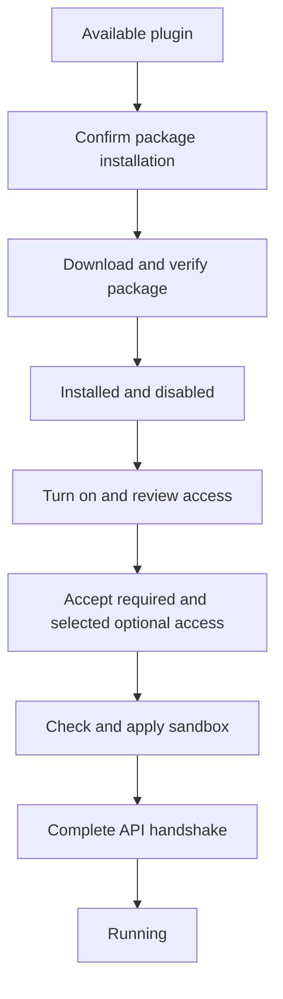

# Plugins

A plugin is a separate program that Among starts to provide status information or
handle notifications. For example, a clock can add text to the window footer, and
a directory plugin can show a different path beneath each terminal pane.

Among draws the interface. Plugins send JSON data through standard input and
output; they do not load code into Among or create GTK widgets. The supported
interface in Among 0.2.0 is managed plugin API 1.2. See the
[plugin API reference](plugin-api.md) for message formats and complete exchanges.

## Contents

- [What plugins can do](#what-plugins-can-do)
- [Installing](#installing)
  - [Installing official plugins](#installing-official-plugins)
  - [Plugin sources](#plugin-sources)
  - [Updates and removal](#updates-and-removal)
- [Access review](#access-review)
- [Confinement](#confinement)
- [Scopes and fragments](#scopes-and-fragments)
- [Notifications](#notifications)
- [Live status examples](#live-status-examples)
- [Versioning and settings](#versioning-and-settings)
- [Failure handling](#failure-handling)
- [Writing a plugin](#writing-a-plugin)
  - [Development mode](#development-mode)
  - [Repository package metadata](#repository-package-metadata)
- [Implementation references](#implementation-references)

## What plugins can do

With the corresponding access granted, a plugin can:

- Add text, icons and small meters to status areas in the window, workspace,
  sidebar or individual panes.
- Read terminal identifiers and selected context, such as a terminal's reported
  directory or title, and receive terminal lifecycle events.
- Read a few system metrics files.
- Keep its own settings and write files in its private data directory.
- Produce notification events, contribute notification controls, or provide a
  notification delivery channel.

The API has no operation for typing into a terminal, reading its scrollback,
opening or closing panes, changing the layout, or executing a command in the
user's shell. Knowing a pane's directory does not grant access to that directory.
Plugins cannot supply arbitrary HTML, CSS or GTK widgets. Network access is
blocked by the sandbox, including for notification delivery plugins.

These API limits and the operating-system sandbox are separate. Read
[Confinement](#confinement) before allowing reduced protection: without Landlock,
the process can access files your account can access even though the API never
sends those files to it.

## Installing

1. Open **Preferences → Plugins**.
2. Find the plugin under **Available** and choose **Install**. The confirmation
   identifies the version, package and requested access.
3. After installation, turn on the plugin under **Installed**.
4. Review its required and optional access, then choose **Accept and enable**.

Installation downloads a ready-built package and leaves a new plugin disabled.
It does not compile code or run an installation script. Among selects a package
for the host architecture and declared runtime requirements, checks its size and
hashes, and verifies its release and manifest before saving it.



A failed check stops that step and displays a reason. Opening a catalogue or
plugin details page does not install or enable code. Copying an executable into
an `among/plugins` directory does not install it either: only committed managed
installation records enter the plugin inventory.

### Installing official plugins

The built-in **Official plugins for Among Terminal** source points to
`Among-Terminal/among-plugins`. It cannot be removed. Official status depends on
pinned numeric repository and publisher identities, not a matching display name.
The official plugins are installed separately through the manager:

| Plugin | Display | Required access |
| --- | --- | --- |
| `clock` | Local time in the application footer | `status` |
| `system-status` | CPU, memory and root filesystem usage in the application header | `status`, `system.metrics` |
| `pane-pwd` | Each pane's reported directory in its footer | `status`, `context.terminals`, `context.cwd` |

The Plugins page uses the saved catalogue when one exists. If the official source
has no saved catalogue, opening the page fetches it once. A failure leaves a
reason and a **Load** or refresh action; it does not retry continuously. Once a
catalogue is saved, use an explicit refresh to check for changes.

### Plugin sources

Use **Add source** to look up a public GitHub repository by `owner/repository` or
repository URL. The preview is read-only. **Add source** saves the registration
and catalogue; **Cancel** saves neither. Among supports up to 32 user sources in
addition to its official source.

The **Sources** page shows saved repositories, catalogue ages and check results.
**Check source** refreshes one repository; **Check all** checks them in order.
A failed check keeps the previous saved list. A publisher change needs explicit
review before its metadata replaces the saved list. That review grants no access
to installed code. A publisher mismatch for the official source is refused.

Repository identity uses GitHub's numeric ID. A rename keeps that identity;
another repository reusing the old name does not inherit it. Removing a source
does not uninstall or stop its plugins, but their updates are no longer offered.

Source checks stop when they observe a GitHub rate limit. The optional
`AMONG_GITHUB_TOKEN` environment variable supplies a token for requests to
`https://api.github.com`; it is not sent to release download hosts. Among removes
it from the environment before starting child processes. The original startup
value can still be visible to the same user through Among's own `/proc` entry,
so use a token with no access beyond reading public data.

### Updates and removal

Refresh the source, then use **Update** when a newer compatible version is
offered. Review the selected version and access requirements. Only the selected
plugin may restart; its settings remain. New required access or a publisher
change can require another runtime access review before it starts.

Among retains the previous verified package generation. In development mode,
**Technical details** offers **Recover previous…**. Recovery still checks access
and compatibility; retaining old bytes is not permission to run them.

**Uninstall** asks for confirmation, stops the plugin and removes its installation.
Local settings are retained and can be removed separately from Preferences.
If stopping or removal fails, the manager reports the failure and keeps the
remaining installation state visible.

## Access review

A *feature* is a named capability in the manifest. A *grant* is a capability the
user has accepted and the host supports. Required features must all be accepted
for the plugin to run. Optional features start unchecked on the first review.
A plugin can decline optional features during its handshake.

| Feature | Access |
| --- | --- |
| `status` | Answer requests for status fragments |
| `settings` | Receive this plugin's validated settings |
| `context.terminals` | Terminal and workspace identifiers, scoped to the request |
| `context.cwd` | Terminal-reported directories |
| `context.title` | Terminal titles |
| `context.process` | Whether terminal processes are running; exit events where available |
| `events.terminal` | Terminal lifecycle, directory and workspace events |
| `system.metrics` | Read `/proc/stat`, `/proc/meminfo` and `/proc/loadavg` |
| `notifications.produce` | Submit notification events |
| `notifications.ui` | Add bounded notification content and action buttons |
| `notifications.deliver` | Receive work for declared notification delivery channels |

Terminal field and event grants require `context.terminals`. They do not expose
terminal output, process command lines or environment variables. A missing grant
means the corresponding context field is omitted. Unknown directories and titles
are `null`; values that exceed the context limits are marked unavailable.

Notification production and delivery are mutually exclusive within one process.
If a plugin offers both as optional features, choose a role explicitly or choose
neither. Notification UI is independent of that role. Changing reviewed access
requires stopping the running plugin first; saving the review alone does not
restart it or enable a delivery channel.

The shield in the plugin row describes its origin and protection status. It is
not an audit of the plugin's code. Open its details to inspect the source,
protection and access.

## Confinement

Among applies Linux Landlock and seccomp before the plugin executable starts.
The child must report that it applied the required protection. A missing or
insufficient result refuses startup.

With full protection, the plugin can read its installed package and the system
paths `/usr`, `/lib`, `/lib64`, `/etc/ld.so.cache` and `/etc/localtime` where present.
Execution is allowed in the package and system directories. It can read and
write its own data directory, supplied through `AMONG_PLUGIN_DATA_DIR`, but cannot
execute files from that directory. The
`system.metrics` grant adds only the three read-only `/proc` files listed above.
Its installed package is read-only.

Seccomp blocks network and local sockets, access to other processes through
debugging and memory APIs, signal sending, shared IPC facilities and selected
kernel operations. Children inherit the sandbox. The environment is cleared and
rebuilt with `PATH`, `LANG`, optional `TZ`, and the private data directory;
`HOME` and the parent's `XDG_*` variables are not inherited.

| Protection available | Startup and file access |
| --- | --- |
| Landlock ABI 3 or newer plus seccomp | Full protection; no reduced-protection consent needed |
| Landlock ABI 1 or 2 plus seccomp | Explicit consent required; this kernel cannot prevent truncation of writable files outside the allowed paths |
| Seccomp without usable Landlock | Explicit consent required; file access is unrestricted within the user's normal permissions |
| No usable seccomp | Plugin cannot start, even with consent |

Preferences reports the observed protection and offers **Allow reduced
protection…** when applicable. If a later kernel provides less protection than
the user accepted, Among asks again.

The sandbox does not impose CPU or memory quotas and does not protect against
kernel vulnerabilities. Install code you trust. Its process supervisor is also
a separate mechanism: a descendant that deliberately leaves the owned process
group remains sandboxed but is no longer stopped with that group.

## Scopes and fragments

A *scope* names the place a status request is asking about. It contains a slot
name and an application, workspace or pane target. Pane and workspace references
are host-issued identifiers, not sidebar positions. A reply belongs to its
request; moving focus does not move that reply to another pane.

| Slot | Location | Target |
| --- | --- | --- |
| `app_header` | Top status strip of the window | Application |
| `app_footer` | Bottom status strip of the window | Application |
| `workspace_header` | Above the active workspace's panes | Workspace |
| `workspace_summary` | Beside a workspace name in the sidebar | Workspace |
| `pane_header` | Above one terminal | Pane |
| `pane_footer` | Below one terminal | Pane |

Application scopes work without terminal context. Workspace and pane scopes
require `context.terminals`. Context is limited to the target: a pane request
contains that pane, a workspace request its panes, and an application request
can contain all terminals. Large lists are paged; see the API reference.

A *fragment* is one piece of status content. For example:

```json
{"text":"MEM 42%","meter":0.42,"tooltip":"Memory usage","priority":20}
```

This is a fragment, not a complete protocol message. A status reply contains an
array of fragments. An empty array clears that plugin's ordinary slot content;
the sidebar exception is described below.
Fragments can have text, a theme icon, tooltip, priority and an optional meter
between 0 and 1. Include readable text alongside a meter. Styles are `success`,
`warning`, `error`, `accent` and `dim`; omitting the style uses the normal
appearance. Unknown status styles fall back to normal. Among controls colours,
font and layout, shortens long text, and drops unavailable theme icons.

Lower numeric priorities appear first, with plugin identity breaking ties.
Each plugin replaces only its own contribution. The sidebar takes the first
fragment from each plugin's workspace summary. Status fragments have no click
actions; notification contributions have a separate action API.

For ordinary slots, the reply's `refresh_ms` requests a polling interval. `null`
or omission means refresh on terminal events. Timing starts from the response;
backpressure can delay the next request. Return empty content for scopes your
plugin does not use.

Workspace summaries currently poll every three seconds regardless of
`refresh_ms`. An empty summary response leaves the previous sidebar contribution
in place instead of clearing it. See [status and fragments](plugin-api.md#status-and-fragments)
for this limitation.

## Notifications

Plugins use the same notification system as terminal bell events. Notification
events pass through the user's channel policies; submitting an event does not
mean a sound played or a desktop notification was delivered.

A producer needs `notifications.produce`. A plugin with `notifications.ui` can
place bounded text and buttons in a supported scope. Clicking a button sends an
action message to that plugin; it does not execute a shell command. Contributions
are tied to the current plugin generation and expire.

A delivery plugin declares channels in its manifest and needs
`notifications.deliver`. The user controls each channel separately. Among sends
delivery requests only to a currently admitted provider and checks its response.
Delivery access does not grant network access or permission to contact desktop
services directly; the sandbox still applies.

See [notification protocol](plugin-api.md) for event targets, delivery responses
and actions, and [Preferences](preferences.md) for bell, sound and desktop
notification controls. The old `notify` message is not a supported way to
produce notifications.

## Live status examples

The official clock uses local time, including `TZ` when supplied to Among.
The resource plugin displays CPU, MEM and DISK percentages and meters in the
shared header. These measurements describe the plugin process's view of the
system, which can differ when Among runs inside a container or package sandbox.

`pane-pwd` reads each pane's last reported directory, including unfocused panes.
The tooltip contains the full path. Unknown directories produce no content.
Among supplies a known initial shell directory; subsequent changes require the
shell to report them through OSC 7.

For Bash, test this in a terminal without changing shell files:

```sh
among_osc7() {
    local LC_ALL=C directory uri='file://' byte encoded i
    directory=$(pwd -P && printf '.') || return
    directory=${directory%.}
    directory=${directory%$'\n'}
    for ((i=0; i<${#directory}; i++)); do
        byte=${directory:i:1}
        case "$byte" in
            [a-zA-Z0-9/._~-]) uri+=$byte ;;
            *) printf -v encoded '%%%02X' "'$byte"; uri+=$encoded ;;
        esac
    done
    printf '\033]7;%s\007' "$uri"
}
PROMPT_COMMAND="among_osc7${PROMPT_COMMAND:+; $PROMPT_COMMAND}"
among_osc7
```

The helper percent-encodes the physical directory using Bash builtins. Add it to
your Bash configuration if wanted. Other shells need their own prompt hook.

## Versioning and settings

Four versions serve different purposes:

| Version | Meaning |
| --- | --- |
| Among `0.2.0` | Application release |
| Plugin `version`, such as `1.3.0` | Package release and update ordering |
| API `major` and `minor` | Runtime protocol; this host speaks `1.2` |
| Settings schema `version` | Structure of the plugin's saved settings |

The manifest declares the minimum API and its required features. The host checks
compatibility before execution. The runtime handshake must then match the
offered API, identity, session and process generation. The old `hello` handshake
cannot start a managed plugin.

Update ordering requires complete Semantic Versioning strings, such as `1.2.0`
or `1.2.0-rc.1`. Values such as `1.2` or `v1.2.0` are valid manifest text but have
no update order: Among will not offer updates for those installed versions.
It refuses lower versions. The same version with different manifest bytes,
package bytes or source commit is a publisher inconsistency, not an update.

Plugins can declare settings fields in their manifest. Among builds the settings
page, validates values and sends them only with the `settings` grant. Saving
settings and applying them are separate: a live configuration reply can accept,
reject or require a restart. A schema that requires restart leaves the new
settings pending until restart. Editing settings does not itself enable a
disabled plugin. See [Preferences storage](preferences.md) and the
[settings schema reference](plugin-api.md).

## Failure handling

Preferences distinguishes **Starting**, **Running**, **Stopping**, **Faulted** and
unavailable or incompatible states. An enabled switch records the user's choice;
it can remain on when a plugin has faulted or cannot start.

A crash, closed output pipe or unanswered status request faults the plugin and
withdraws its status content. Admission and status replies have five-second
deadlines. At most three automatic restarts follow a fault, after delays of 2, 4
and 8 seconds. Turning the plugin off and on resets that allowance. Missing or
incompatible executables are not automatically retried.

Malformed or out-of-range messages are rejected. They do not complete a pending
request, so repeatedly sending invalid replies can still lead to its timeout.
Oversized frames or overflowing transport queues fault the plugin. A frame is
limited to 64 KiB including its newline, and each pipe queue holds at most 16
frames. Old-generation, duplicate and unmatched replies cannot restore content.

Stopping sends TERM to the supervised process group, then KILL after 500 ms if
needed. The host waits for the supervised leader and confirmation that its group
is gone before starting a replacement of the same identity. **Stopping** can
therefore persist if group disappearance cannot be confirmed. Other identities
can use free slots in the application-wide limit of 32 supervised generations.

Standard error is discarded. A generic `error` message does not display arbitrary
diagnostic text to the user. Use the defined configuration outcomes and
notification responses in the API reference, and exit for an unrecoverable
failure. Keep ordinary logging off stdout: it is the protocol channel.

## Writing a plugin

1. Choose an executable and declare only the features it needs. A simple
   application-footer plugin needs `status`, without terminal context.
2. Add `among-plugin.json` using manifest schema 1. See the minimal manifest and
   full request/reply exchange in the [API reference](plugin-api.md).
3. Read one JSON message per line from stdin. Complete `managed_hello`, preserve
   the host-issued bindings, answer status requests and flush every reply.
4. Write persistent data only under `AMONG_PLUGIN_DATA_DIR`. Treat the package
   directory as read-only. Handle denied optional features and missing context.
5. Build and package the executable, manifest and licensing material. Test it
   through the local catalogue flow below, then publish a release catalogue.

Among launches the executable directly and supplies no language runtime.
An installed script must use exactly the interpreter declared by its package,
for example `#!/usr/bin/bash` followed by LF. Shebang arguments, spaces, CRLF
and `/usr/bin/env` wrappers are refused. Native packages must contain a matching
Linux ELF64 executable. Runtime and dependency checks inspect files; they do not
run version probes or installation hooks.

### Development mode

Quit Among, then start `among --plugin-development`. The flag applies only when
starting the first instance and is not saved. Passing it to an already running
instance exits with status 2 instead of changing that instance's mode.

Preferences then offers **Install from a local catalogue** and a
**Stable / Pre-release** selector, initially on Pre-release. Choose a schema-2
`among-plugins.json` with its package files alongside it. Opening the file only
reads metadata; **Review…** begins the installation flow. The catalogue, package
and directory must be owned by you and not writable by others or by a group
other than your primary group. Symbolic links are refused. Changed catalogue
bytes, package sizes or hashes refuse installation.

A local install uses `development/<plugin-id>`. A repository install uses
`github:<numeric-repository-id>/<plugin-id>`. Build your plugin to accept the
appropriate identity during admission. A published executable that insists on
its repository identity will not complete a local-development handshake.
Local packages have no verified repository, publisher or release provenance.

Replacing a local installation or replacing an installed package with a
prerelease requires confirmation, starts disabled and does not inherit its old
access grants. The previous generation remains available. Development and
prerelease installations remain listed in ordinary runs, but start only with
`--plugin-development`.

Prerelease checks inspect at most three pages of 100 releases and select the
non-draft prerelease with the latest creation time among those observed. This
does not promise the newest prerelease beyond that bounded list. Prerelease
catalogues are not saved. They undergo the same package and release checks as
stable catalogues. A later compatible stable release can update a prerelease;
the same version can become stable only when its bytes and commit match.

### Repository package metadata

Repository installation is implemented in 0.2.0. Publish ready-built `tar.gz`
packages and an `among-plugins.json` asset in a public GitHub Release. Stable
discovery uses GitHub's latest release and requires it to be non-draft,
non-prerelease and immutable. The catalogue is release metadata, not a file read
from the repository's default branch.

Use this schema-2 structure. All listed fields are required unless marked
optional; unknown fields and duplicate JSON keys are rejected.

| Object | Fields |
| --- | --- |
| Catalogue | `schema_version: 2`, `plugins`: nonempty array of plugin entries |
| Plugin entry | `id`: local plugin ID, `versions`: array containing exactly one version |
| Version | `revision`: 40-character lowercase Git commit SHA; `manifest_sha256`: 64-character lowercase SHA-256; `manifest`: schema-1 manifest object; `artifacts`: nonempty array |
| Artifact | `os: "linux"`, `architecture: "amd64"` or `"arm64"`, `runtime`, `dependencies`, `format: "tar.gz"`, `asset`: exact release filename, `size`: compressed bytes, `sha256`: compressed-file hash, `members`: regular-file list |
| Native runtime | `kind: "native"`, `libc: "glibc"` or `"musl"`, `minimum`: numeric libc version string |
| Script runtime | `kind: "script"`, `executable`: installed `/usr/bin/<name>`, optional `minimum` |
| Dependency | `executable`: installed `/usr/bin/<name>`, optional `minimum` |
| Member | `path`: package-relative path, `size`: bytes, `sha256`: file hash, `executable`: boolean |

For a single plugin, the root may instead contain `schema_version: 2` and the
version fields directly. The manifest's `id` must match the plugin entry.
`dependencies` may be an empty array. A non-null script or dependency `minimum`
makes that artifact unavailable because the host does not run version
probes. Native selection currently measures glibc; it does not invent a musl
version. Exactly one artifact must match the host.

Every package must contain `among-plugin.json` and the declared executable
entrypoint. `manifest_sha256` hashes the exact packaged manifest bytes, not a
reformatted JSON object. Include every regular file in `members`, with its exact
size, hash and executable flag. Symlinks, hard links, special files, undeclared
members and unsafe paths are refused. Relative paths cannot contain empty, `.`
or `..` components. No extraction or install hooks are supported.

The catalogue is limited to 1 MiB, 32 plugins and 8 artifacts per version.
A package is limited to 64 MiB compressed and 256 MiB expanded, with at most
2,048 regular files. Individual files cannot exceed 64 MiB; manifests are limited
to 256 KiB. Hashes use 64 lowercase hexadecimal characters.

Among obtains numeric release and asset IDs from GitHub; do not put `release_id`
or `asset_id` in the catalogue. The release inventory must have at most 64 assets,
each uploaded and carrying a valid size and SHA-256 digest, including assets not
selected for this host. It must contain exactly one `among-plugins.json`.

The selected release tag must resolve to each version's `revision`. Installation
rechecks repository identity, publisher, release inventory and tag resolution
before committing the selected generation. A change requires a new refresh and
review. Matching hashes and commits establish content consistency; they do not
prove a reproducible build or independently authenticate its publisher.

## Implementation references

- [Managed messages and grants](../src/plugin/managed.rs),
  [host admission and replies](../src/plugin/host/managed_runtime.rs),
  [status rendering](../src/slots.rs).
- [Manifest](../src/plugin/manifest.rs), [settings schema](../src/plugin/schema.rs),
  [package catalogue](../src/plugin/install/metadata.rs),
  [entrypoint validation](../src/plugin/install/entrypoint.rs).
- [Repository installation](../src/plugin/install/source.rs),
  [archive validation](../src/plugin/install/package.rs),
  [local installation](../src/plugin/install/local.rs),
  [plugin manager](../src/prefs/plugin_manager.rs).
- [Sandbox rules](../src/plugin/sandbox/policy.rs),
  [sandbox launch](../src/plugin/sandbox/launch.rs),
  [protection levels](../src/plugin/sandbox/level.rs),
  [child environment](../src/plugin/host/environment.rs).
- [Notification bridge](../src/plugin/host/notification_backend.rs),
  [notification model](../src/plugin_notifications.rs),
  [process supervision](../src/plugin/process.rs).
