# Preference storage and integration

User controls are documented in [preferences](https://among-terminal.github.io/preferences/)
and [plugins](https://among-terminal.github.io/plugins/). Settings use
`$XDG_CONFIG_HOME/among`, falling back to `$HOME/.config/among` when
`XDG_CONFIG_HOME` is absent or empty.

## Notifications

`general.json` uses version 1. Missing fields inherit these in-memory defaults;
opening Preferences never writes the document:

```json
{"version":1,"notifications":{"visual":{"enabled":true,"eligibility":"originating-terminal-unfocused"},"audio":{"enabled":false,"eligibility":"application-background","source":"builtin"},"desktop":{"enabled":true,"eligibility":"application-background"},"command":{"enabled":false,"eligibility":"application-background"}}}
```

Keep serialized eligibility values compatible with `Policy::permits` in
[notifications.rs](../src/notifications.rs): `originating-terminal-unfocused`
requires a source terminal, even when the application is in the background.
Indicator presentation belongs to the
[terminal bell backend](terminal-bell-backend.md).

Command edits preserve literal argument strings. Arguments that cannot fit the
one-argument-per-line editor, such as an empty string or a line break, remain a
JSON list. Saving or enabling performs neither execution nor cwd preparation;
an eligible event triggers bounded preparation off the GTK loop. The environment
is `PATH`, `LANG` and `HOME`, plus `XDG_RUNTIME_DIR`, `DBUS_SESSION_BUS_ADDRESS`,
`DISPLAY`, `WAYLAND_DISPLAY` and `XAUTHORITY` only when set in Among's environment.
See [command execution](notification-commands.md).

An absent Desktop field enables the default for existing profiles. An unreadable
or invalid document disables Desktop for the session and retains the diagnostic
and original file. Program-controlled notification text is cleaned and bounded.
During the final session write, activation only raises the window, preserving the
captured workspace, terminal and layout; cancelling close restores navigation.
A failed Desktop policy update withdraws notifications without saving the change.
Only a Desktop edit retries it; other channels and idle ticks do not.
See [desktop registration](install.md#desktop-notification-integration).

Audio selection reads and validates asynchronously, accepting only an immutable
snapshot. Preview bypasses notification ingress and does not change policies,
unread state, commands or providers. Replacing a sound cancels and retires the old
decoder first. A Busy result retains no replacement; an unconfirmed retirement
disables playback. A newer diagnostic must not be overwritten by an older result.
Stop requests cancellation without persisting playback success. Decoder end and
accepted requests do not prove output. Audio is cancelled when permission is
revoked, its pane is removed or its provider stops. See [audio](audio.md).

Provider choices are keyed by full provider identity and channel ID under
`notifications.providers[identity].channels[channel]`. The page distinguishes
desired enablement from process admission. Inspection cannot start a plugin.
Edits re-read and merge their own fields, preserving unknown keys and other
providers. JSON must have bounded size and unique keys; paths must be safely
owner-controlled. Fresh files are private; existing safe directory permissions
are preserved. Future versions, invalid known fields, symlinks and malformed
documents are reported without repair. Settings remain outside packaged trees.
Transient attention, operation IDs and pending jobs are never persisted.

## Stored settings

Managed choices, reviews, reduced-protection consent and plugin settings use
`managed-plugins.json`, version 1. Its `plugins` object is keyed by full identity,
such as `github:123/clock`, keeping repositories' preferences separate.

The old `plugins.json` is untouched and is not used for managed enablement.
Its legacy fixture remains part of the storage compatibility tests:

```json
{"plugins": [{"name": "clock", "enabled": false}]}
```

Reduced-protection consent uses `reduced:1`, `reduced:2` and `seccomp-only`
in `protection_consent`; each token covers that level and stronger ones.
Notification access review stores identity/publisher-scoped `review.features`
without enabling code or channels. See the site's
[access review](https://among-terminal.github.io/plugins/#access-review)
and [reduced protection](https://among-terminal.github.io/plugins/#reduced-protection)
controls.

Shortcut overrides use `shortcuts.json`, version 1:

```json
{"version": 1, "overrides": {"split-pane": "<Control><Shift>b", "toggle-zoom": null}}
```

An absent override inherits the current default; null explicitly unbinds it.
Reassigning an occupied binding persists the displaced action as unbound.
Cancelled capture and rejected or unchanged edits do not write overrides.

Expanded sidebar width uses `window.json`, version 1, in logical pixels:

```json
{"version": 1, "sidebar_width": 420}
```

The collapsed strip stays fixed-width. A constrained window must not replace the
saved preference. With no saved width, use the adaptive default. Zero, negative
and non-numeric values are rejected.

Terminal appearance uses `terminal.json`, version 1:

```json
{"version": 1, "text_background": "gnome-terminal-default", "ansi_palette": "tango"}
```

Preserve the serialized identifiers and missing-field defaults validated by
[settings/terminal.rs](../src/settings/terminal.rs). The startup reader in
[terminal_appearance_source.rs](../src/terminal_appearance_source.rs) must remain
read-only. Keep source selection separate from effective colours in
[terminal_appearance.rs](../src/terminal_appearance.rs), so fallback never rewrites
the saved choice and failure in one dimension does not discard the other.
When applying `VteCompiledDefaults`, [pane.rs](../src/pane.rs) must pass an empty
palette to VTE to clear any previously applied explicit palette.

The [settings writer](../src/settings.rs) must retain unknown fields and entries
on unrelated saves. Writes use a private same-directory temporary file and atomic
replacement. Failure before replacement
preserves the old document; failure confirming directory durability reports
uncertainty. Symlink destinations are refused. Detected external edits are merged;
simultaneous external writers are not fully serialized.

Plugin forms distinguish `Saved locally`, `Accepted for this session; not saved
locally` and `Written locally; durability not confirmed`. These results remain
independent of pending, applied, rejected and restart-required process state.
Saving a restart-mode edit or opening a form cannot restart a plugin without
separate confirmation. Plugin faults do not alter saved desired enablement.
Later edits retry only their settings category and clear its warning on success.

## View integration

Pages are ordered Plugins, Notifications, Keyboard, Terminal and About, with
Plugins initially visible and equally wide tabs. Preferences and the repository
inspector are nonmodal parented native windows; other forms retain their own
interaction rules. Background registration and process changes update inventory
rows by identity without rebuilding focused controls each tick.

Terminal dropdown widget names are `terminal-text-background` and
`terminal-ansi-palette`. The embedded catalogue follows GNOME Terminal 3.56.2.
Preferences requests 820 logical pixels of width. Initial height fits About
within desktop space when possible, with a minimum of 576 logical pixels.
Pages scroll when necessary.

Development mode adds provenance, digests, generation, granted features, policy
digest, Landlock ABI/enforcement, seccomp result and refusal reason to Technical
details. Recovery controls are described in the template's
[development guide](https://github.com/Among-Terminal/among-plugin-template/blob/main/docs/guide.md#development-mode).

The `about` page reads compiled-in identity and `os-release`, never git or the
network. Build text is `Build <short commit> · <date>`, omitting unavailable parts
or showing `Build unknown` when both are missing. The fallback version comes from
`Cargo.toml`. See [build identity](build.md#build-identity). Operating-system text
uses `PRETTY_NAME` from `/etc/os-release`, then `/usr/lib/os-release` if the first
cannot be read, otherwise `unknown`. Copy build details emits four lines:

```text
Among Terminal 0.2.0
Commit: unknown
Built: unknown
System: Debian GNU/Linux 13 (trixie)
```

## Screenshots

The graphical test and `among-tools` generate these images; see
[Preferences screenshots](testing.md#preferences-screenshots). Sample plugins and
the second source are synthetic. Dark styling is used unless marked light.

| View | Image |
|---|---|
| Plugins | 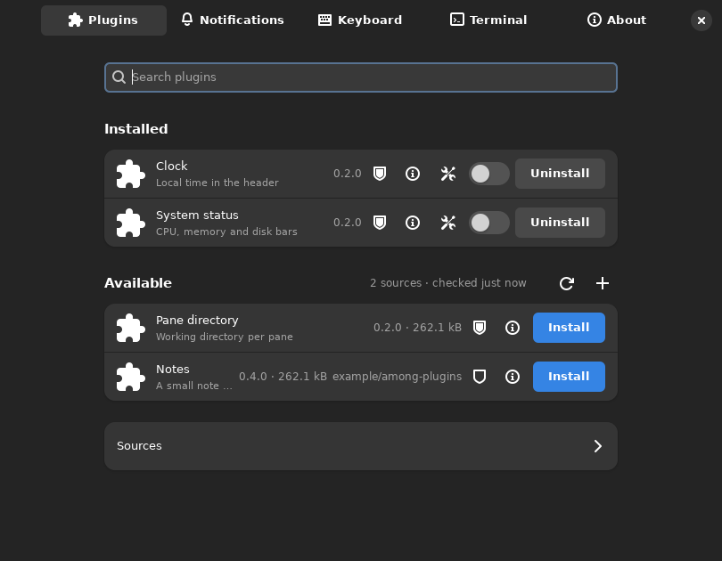 |
| Plugins, light | 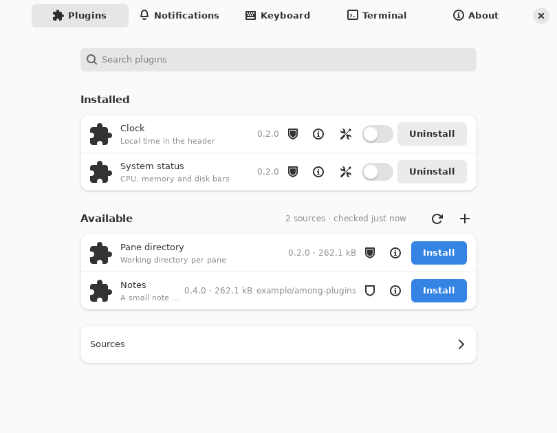 |
| Plugin info | 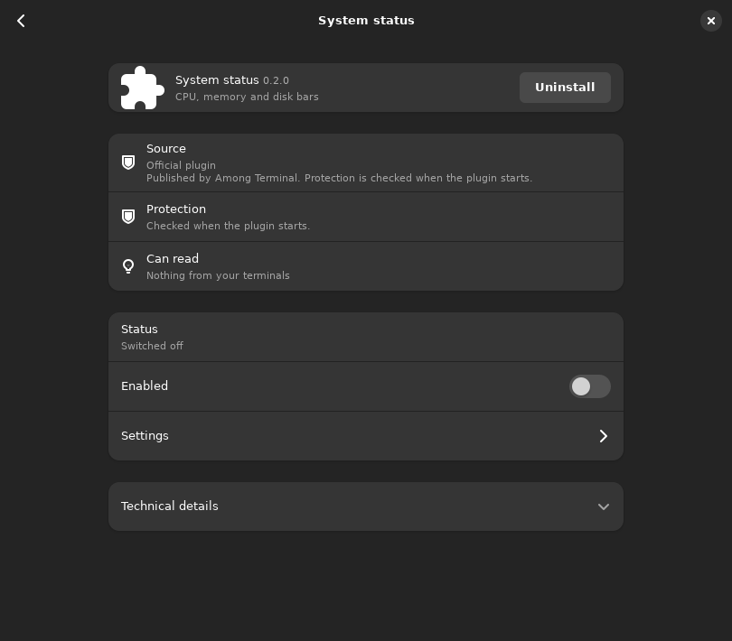 |
| Access review | 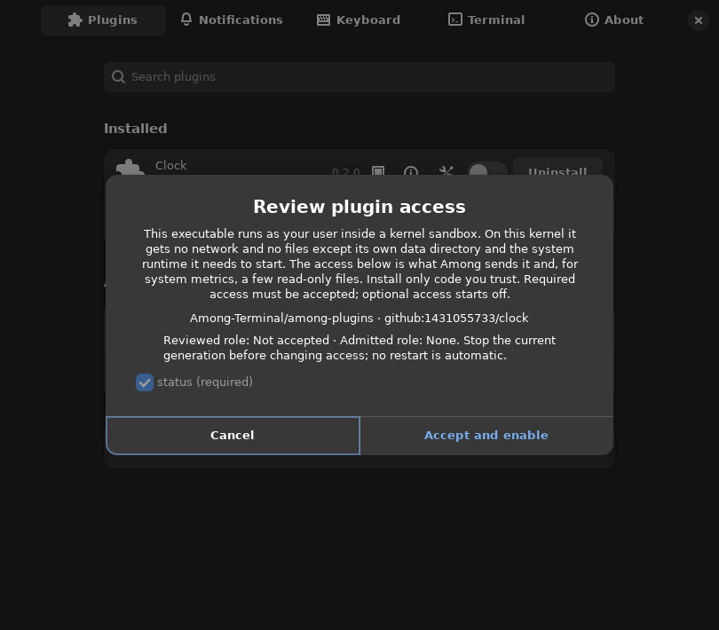 |
| Sources | 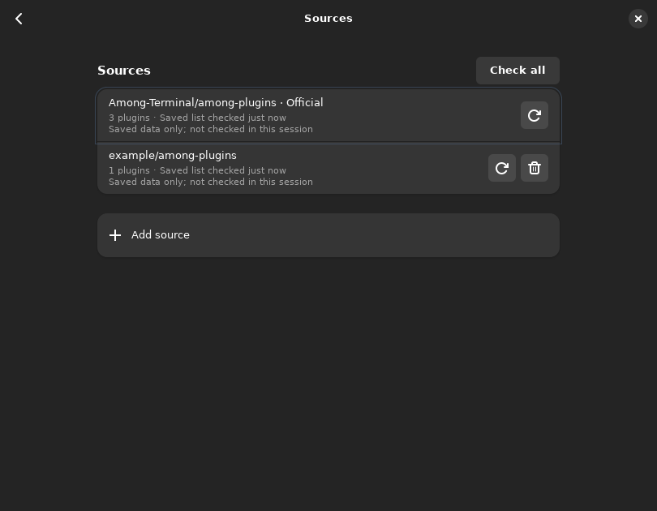 |
| Notifications | 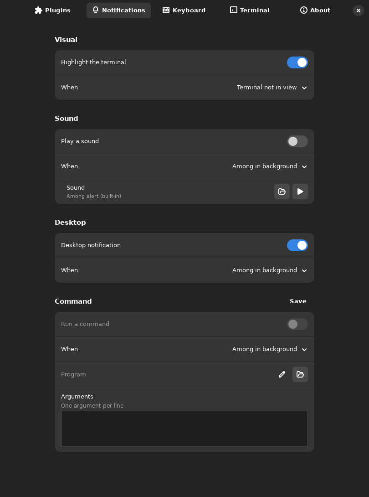 |
| Keyboard | 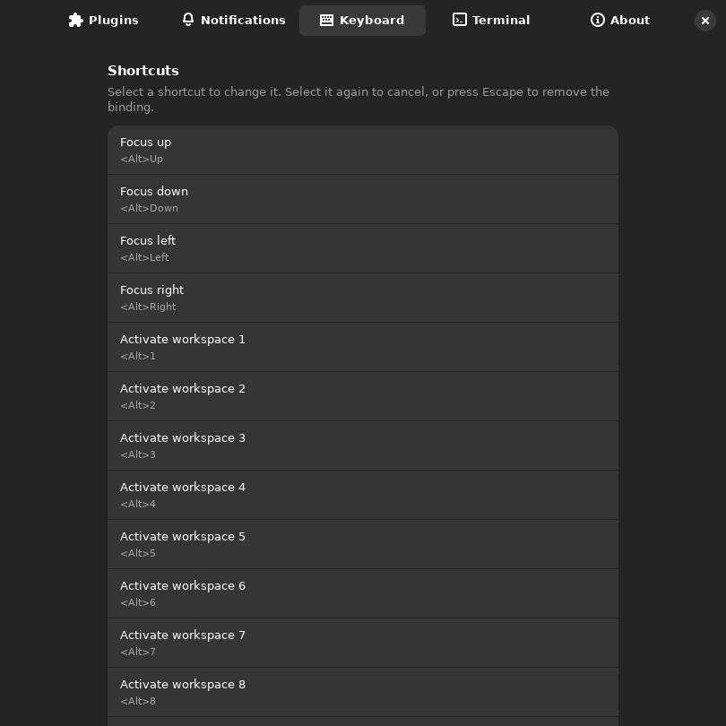 |
| Terminal | 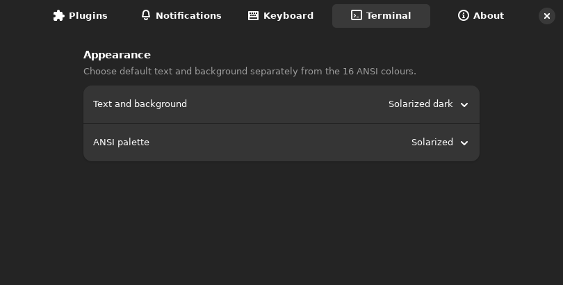 |
| Terminal, light | 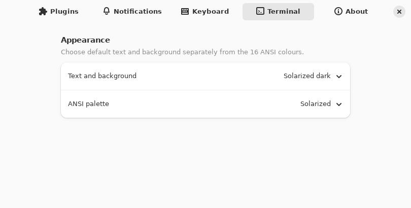 |
| About | 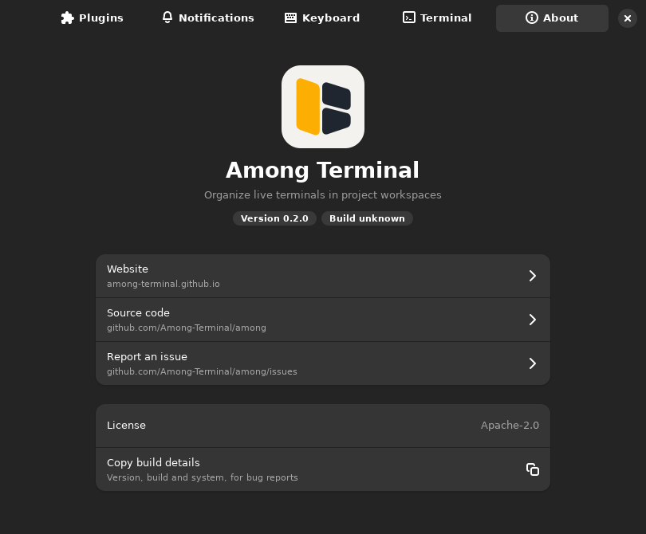 |
| First load, no saved sources |  |
| Offline failure | 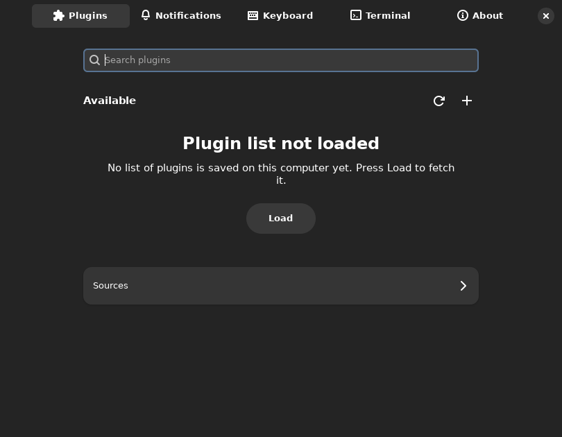 |
| Search | 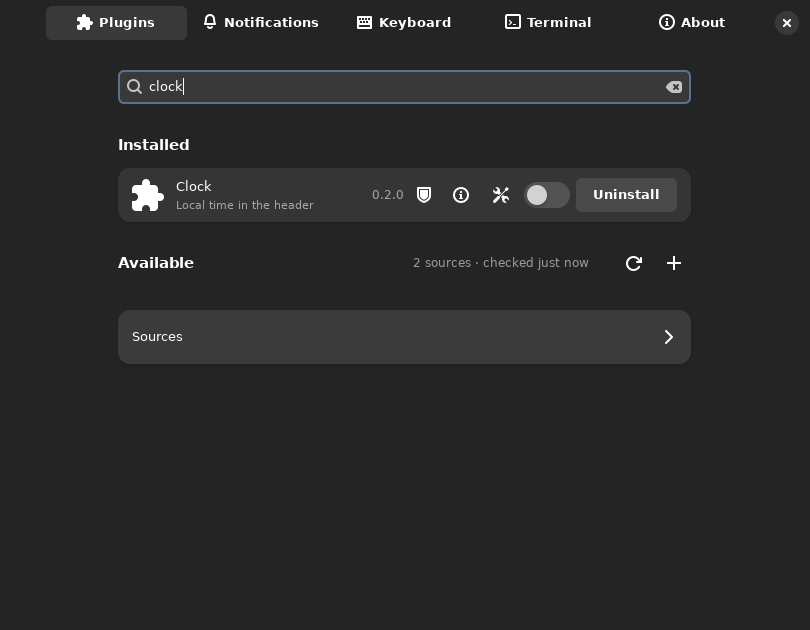 |
| Add source | 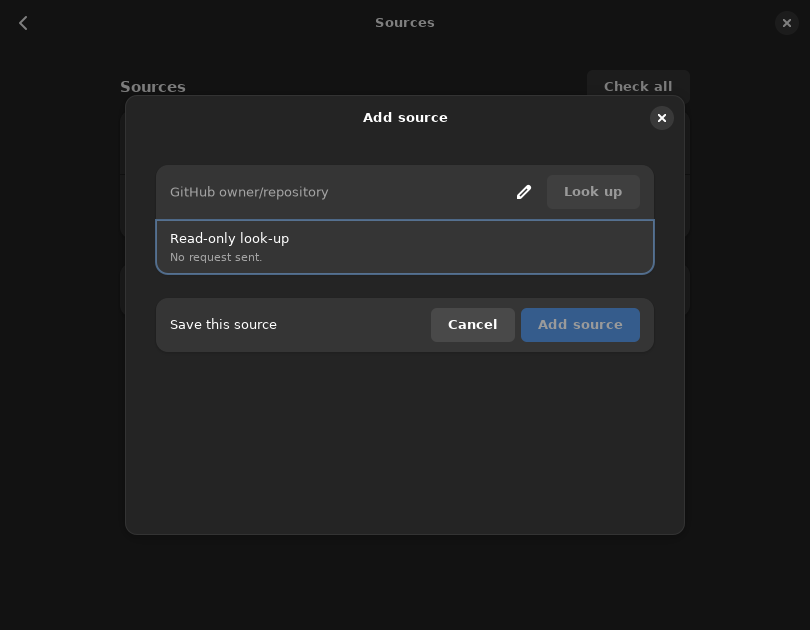 |
| Command arguments | 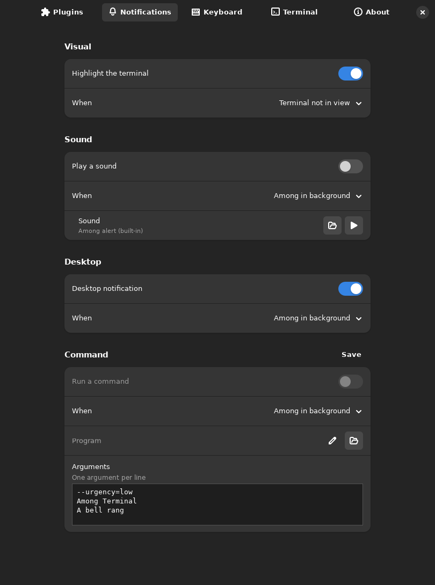 |
| Main window | 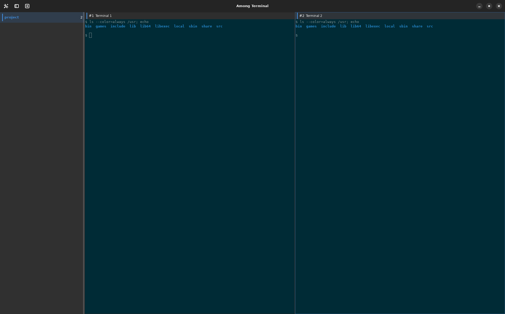 |
| Bell indicator | 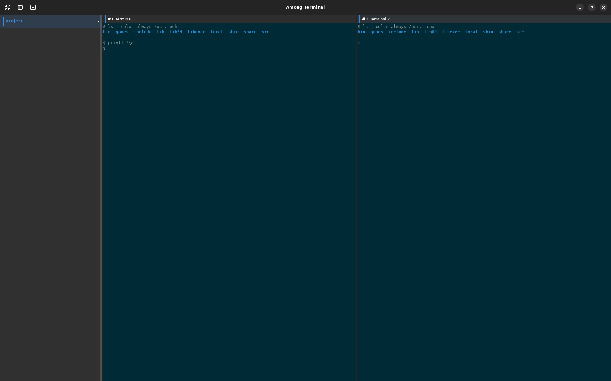 |
| GNOME Shell desktop notification |  |

The open terminal dropdown is not covered: without a compositor its popup renders
black. High-contrast styling is selected by the environment before startup and is
not covered. The capture display has no audio device, so the playing sound row is
not covered either.
